# 「有恒」小程序设计需求文档说明书

| 项目 | 内容 |
| --- | --- |
| 文档名称 | 「有恒」小程序设计需求文档说明书 |
| 文档版本 | V1.4（新增日志审计管理） |
| 产品名称 | 有恒（youheng） |
| 工程代号 | youheng |
| 平台形态 | 微信小程序 + 后台管理 Web |
| 技术栈 | Java / Spring Boot / MySQL / Redis / Flyway / Spring Security |
| 文档状态 | 待评审 · 评审通过后冻结为基线版本 |
| 适用范围 | 产品、后端、前端、测试、运营 |

**修订记录**

| 版本 | 日期 | 修订人 | 修订内容 |
| --- | --- | --- | --- |
| V1.0 | 初稿 | 产品 | 依据需求方口述整理：打卡计划、拍照证明、自动审核、后台八大管理模块、用户端六大功能、技术架构 |
| V1.1 | 修订 | 产品 | 新增补卡券与奖励机制（5.9、6.10、7.8、8.2、9.2/9.3 接口、AC-15~24）；分享发券按合规要求降级为 P2 默认关闭；工程名统一为 youheng |
| V1.2 | 修订 | 产品 | 新增 11.5 原型设计图（小程序 8 张 + 后台 2 张线框稿）及逐页元素说明，图片存于 `docs/images/prototypes/` |
| V1.3 | 修订 | 产品 | 新增邀请体系（5.10 三类邀请、6.11 邀请管理、7.9 关系与奖励判定、3 张新表、9.2/9.3 接口、AC-25~32、P-17 原型）；明确"邀请参加我的计划"为复制模式 |
| V1.4 | 修订 | 产品 | 新增日志审计管理（6.13 后台模块、7.10 采集规则、2 张新表 + 1 张告警表、A-42~47 接口、AC-33~38、A-18 原型）；明确审计日志与访问日志/业务日志的分层职责 |

---

## 目录

1. [文档概述](#1-文档概述)
2. [产品概述](#2-产品概述)
3. [总体架构与技术选型](#3-总体架构与技术选型)
4. [角色与权限矩阵](#4-角色与权限矩阵)
5. [用户端功能需求](#5-用户端功能需求)
6. [后台管理功能需求](#6-后台管理功能需求)
7. [核心业务规则](#7-核心业务规则)
8. [数据模型设计](#8-数据模型设计)
9. [接口设计](#9-接口设计)
10. [非功能需求](#10-非功能需求)
11. [页面清单与交互流程](#11-页面清单与交互流程)
12. [视觉与文案规范](#12-视觉与文案规范)
13. [验收标准](#13-验收标准)
14. [里程碑与版本规划](#14-里程碑与版本规划)
15. [风险与待确认事项](#15-风险与待确认事项)
16. [附录](#16-附录)

---

## 1. 文档概述

### 1.1 编写目的

本文档描述「有恒」微信小程序 V1.0 的产品需求、业务规则、数据模型、接口约定与验收标准，作为产品、开发、测试、运营四方对齐的基线。凡本文档未约定的实现细节，由开发在评审会上提出并以本文档的修订版本记录，不得口头约定。

### 1.2 读者对象

| 角色 | 关注章节 |
| --- | --- |
| 产品/运营 | 第 2、5、6、12、14 章 |
| 后端开发 | 第 3、7、8、9、10 章 |
| 小程序前端 | 第 5、7、11、12 章 |
| 后台前端 | 第 6、11 章 |
| 测试 | 第 5、6、7、13 章 |

### 1.3 名词术语

| 术语 | 英文/字段 | 定义 |
| --- | --- | --- |
| 打卡计划 | Plan | 用户自建的一个持续性目标，是打卡行为的最小容器（如"30 天不撸""连续吃早餐"）。一个计划可关联 1~3 个标签 |
| 标签 | Tag | 平台维护的打卡分类，如健身、学习、跑步、篮球、单词计划、睡眠、早餐。用于归类、排名与内容分发 |
| 打卡 | Check-in | 用户在某个自然日内对某个计划提交的一次带图片（必选）与文字（可选）的记录 |
| 坚持纪律 | Discipline | 计划页的核心数据看板：当前连续天数、最长连续、累计打卡、完成率、平均间隔、纪律评级 |
| 连续天数 | Streak | 自最近一段未中断的连续有效打卡起，累计的日历天数 |
| 补签 / 补卡 | Make-up | 用户对已过去的某一天补交打卡，用于修复断签。V1.0 统一称"补卡"，必须消耗补卡券 |
| 补卡券 | Makeup Card | 用户唯一可消耗道具，1 张 = 补 1 天。获取途径：完成挑战、连续里程碑、看激励视频广告、运营发放 |
| 账本 | Card Ledger | 补卡券余额变动的流水表，是余额的唯一可信源，用于幂等、对账与客服追溯 |
| 激励视频广告 | Rewarded Video | 微信流量主广告，用户完整观看后由平台回调，据此发放 1 张补卡券 |
| 挑战计划 | Challenge | 平台发布的官方活动，如"半个月连续 10km 跑步 10 次"，完成者获得对应勋章 |
| 勋章 | Badge | 达成里程碑或完成挑战后颁发的虚拟荣誉，不可交易 |
| 打卡圈 | Circle | 用户公开打卡内容的社区信息流，支持点赞、评论、举报 |
| 机审 | Machine Audit | 调用微信内容安全接口 + 本地规则库对图片/文字自动判定 |
| 人审 | Manual Audit | 后台运营对机审疑似或用户申诉内容的人工复核 |
| 审计日志 | Audit Log | 记录"谁在何时对什么做了什么、结果如何"的不可篡改结构化流水，用于合规、客服与风控，区别于供开发排障的文本日志 |

### 1.4 需求编号与优先级

- 需求编号：`FR-<模块号>.<序号>`，如 `FR-5.3`。
- 优先级：**P0** 首版必须；**P1** 首版尽量；**P2** 后续版本。
- 状态：`待开发` / `开发中` / `待验收` / `已完成` / `已搁置`。

### 1.5 命名与目录约定（重要）

此前需求稿中出现过三种英文拼写：架构章节的 `yuhen`、文档文件名的 `youhen`、仓库目录的 `youheng`。现经确认，**以实际仓库目录 `E:\person\youheng` 为准**，全文统一采用 **中文名｜有恒**、**工程名｜youheng**，另外两种拼写作废，不得再用于目录、包名、数据库名、分支名或文档文件名。

| 项 | 取值 |
| --- | --- |
| 本地仓库根目录 | `E:\person\youheng` |
| 项目工程名 | `youheng` |
| 文档目录 | `youheng/docs` |
| Java 包名 | `com.youheng` |
| 数据库名 | `youheng` |
| 小程序 AppID | 占位 `wx0000000000000000` |
| Redis Key 前缀 | `yh:` |
| 表前缀 | 无（按业务域直接命名，见第 8 章） |

> 命名决议已于 V1.0 冻结。新增文件、接口路径、Git 分支命名均须遵循本表，评审时以本表为唯一标准。

---

## 2. 产品概述

### 2.1 一句话定位

用照片证明每一次坚持，把连续天数变成看得见的纪律、比得出的名次、收得到的勋章。

### 2.2 品牌基调与首页文案

- 首页顶部固定展示曾国藩语录：**「人而无恒，终身一无所成。」**
- 副文案（轮换，每次进入随机一条）：`日日不断，功不唐捐。` / `有恒者，事竟成。` / `今天，是第 N 天。`
- 基调关键词：**克制、有刻度、复古奖章**。不做打鸡血的弹窗，不做诱导分享。

### 2.3 目标用户与典型场景

| 人群 | 画像 | 典型计划 | 核心诉求 |
| --- | --- | --- | --- |
| 自律改造型 | 18~28 岁男性为主 | 30 天不撸、戒熬夜、戒烟 | 连续天数极其敏感，怕断签，需要"证据"自我约束 |
| 训练目标型 | 20~35 岁，有运动习惯 | 连续 30 天有氧、10km 跑步 10 次 | 要进度、要排名、要勋章成就感 |
| 学习成长型 | 18~25 岁学生 | 单词计划、每天读书 30 分钟 | 喜欢排行榜与打卡圈互动 |
| 生活方式型 | 25~35 岁女性为主 | 连续 10 天吃早餐、喝水、护肤 | 记录美观、愿意分享海报 |

**典型场景 A（私密自律）**：用户创建"不撸"计划，设为私密（不同步打卡圈），每日上传一张状态截图。第 30 天收到「三十日」勋章，在"自律"标签榜中看到自己排第 12 名。

**典型场景 B（公开分享）**：用户创建"吃早餐"计划并勾选同步打卡圈，拍照打卡，第 10 天获得铜章并生成海报分享到朋友圈，带来新用户。

**典型场景 C（挑战活动）**：用户报名"半个月 10km 跑步 10 次"挑战，完成第 10 次后由定时任务自动结算、颁发专属勋章，并在挑战详情页显示"已完成 1,204 人"。

### 2.4 与竞品的差异点

| 竞品类型 | 代表 | 弱点 | 本产品差异 |
| --- | --- | --- | --- |
| 社群打卡工具 | 各类"小打卡" | 重社群运营、个人成就体系弱 | 以**个人连续纪律**为核心，社群是附属 |
| 专注/计时工具 | Forest 类 | 以"次"或"分钟"计，与"天"无关 | 以**自然日**为最小单位，天然适合长期习惯 |
| 习惯清单 App | 各类 habit tracker | 无证明、无排名、无审核 | **照片证明 + 榜单 + 机审**三位一体 |
| 官方运动数据 | 微信运动 | 维度单一 | 标签自定义，任何行为都能建计划 |

### 2.5 目标指标（上线 3 个月）

| 指标 | 定义 | 目标 |
| --- | --- | --- |
| 次日留存 | 注册次日有打卡的用户占比 | ≥ 40% |
| 7 日留存 | 注册第 7 日仍有打卡 | ≥ 25% |
| 30 日留存 | 注册第 30 日仍有打卡 | ≥ 12% |
| 人均计划数 | 注册用户平均创建计划数 | ≥ 1.5 |
| 周打卡频次 | 活跃用户人均周打卡次数 | ≥ 4 |
| 勋章触达率 | 获得 ≥1 枚勋章的用户占比 | ≥ 60% |
| 机审准确率 | 机审结果与人审一致的比例 | ≥ 95% |
| 补卡券使用率 | 已发放券中被使用的比例（30 天内） | ≥ 50% |
| 广告完播率 | 拉起的激励视频中完播比例 | ≥ 70%（行业参考值） |
| 补卡后留存提升 | 使用过补卡的用户 30 日留存 vs 未使用 | 高 5 个百分点以上 |
| 邀请转化率 | 落地页访问 → 成功注册/接受的比例 | ≥ 25% |
| 邀请 K 因子 | 人均有效邀请数 × 邀请转化率 | ≥ 0.15（单月） |
| 邀请有效率 | 有效邀请 ÷ 总邀请记录（剔除风控无效） | ≥ 80% |

---

## 3. 总体架构与技术选型

### 3.1 工程目录结构

```
youheng/
├── backend/                 # 后端服务（Spring Boot 单体，按模块分包）
│   ├── youheng-common/      # 通用：统一响应、异常、工具、枚举
│   ├── youheng-api/         # 启动模块（Controller 层）
│   ├── youheng-service/     # 业务逻辑
│   ├── youheng-dao/         # 持久层（Mapper）
│   ├── youheng-integration/ # 外部集成（微信登录、内容安全、对象存储）
│   └── youheng-job/         # 定时任务
├── miniprogram/             # 微信小程序前端
├── admin-web/               # 后台管理前端（Vue 3 + Element Plus）
├── docs/                    # 需求、接口、数据库设计、交付文档
├── deploy/                  # Dockerfile、compose、Nginx、SQL 基线
└── README.md
```

**后端分包规范**（`com.youheng.<模块>`）：`controller / service / mapper / entity / dto / vo / converter`。禁止 Controller 直接调用 Mapper。

### 3.2 技术选型

| 层 | 选型 | 说明 |
| --- | --- | --- |
| 语言 | Java 17（LTS） | 与 Spring Boot 3.x 匹配 |
| 框架 | Spring Boot 3.2.x | 单体优先，按模块可拆分 |
| 安全 | Spring Security + JWT | 小程序端与后台端双 Realm 隔离 |
| 持久层 | MyBatis-Plus 3.5.x | 分页、逻辑删除、自动填充 |
| 数据库 | MySQL 8.0 | 字符集 `utf8mb4`，排序 `utf8mb4_0900_ai_ci` |
| 版本管理 | Flyway | `V<版本>__<描述>.sql`，禁止手改已执行脚本 |
| 缓存 | Redis 7 | 榜单 ZSET、验证码、幂等锁、在线统计 |
| 对象存储 | 阿里云 OSS / MinIO | 私有读，预签名 URL 访问 |
| 定时任务 | Spring Task + ShedLock | 多实例防重跑 |
| 接口文档 | SpringDoc OpenAPI 3 | 自动生成 `/swagger-ui` |
| 小程序端 | 原生小程序 + TypeScript | MVP 阶段不引入跨端框架 |
| 后台前端 | Vue 3 + Element Plus + Vite | 中后台标准组合 |
| 日志 | Logback + MDC traceId | 结构化 JSON 输出 |
| 监控 | Spring Boot Actuator + Prometheus | 关键指标埋点 |

### 3.3 部署拓扑

```
           ┌──────────────┐
 微信小程序 →│  Nginx       │→ /api/*  → Spring Boot (:8080) ─┬→ MySQL 8（主从）
 管理后台  →│  (:443)      │→ /admin/* → 同上（鉴权隔离）      ├→ Redis 7（单机+哨兵）
           └──────────────┘→ 静态资源 → admin-web 构建产物  └→ OSS/MinIO（图片）
                                        Spring Task（结算、榜单快照、统计汇总）
```

- 环境：`dev`（开发）、`test`（测试）、`prod`（生产），三套独立数据库与 Redis DB。
- 配置：`application-{env}.yml` + 环境变量注入敏感项（数据库密码、微信 Secret、OSS AK/SK），**严禁入库入仓**。

### 3.4 数据库版本管理规范

1. 所有变更走 Flyway，文件置于 `backend/youheng-dao/src/main/resources/db/migration`。
2. 命名：`V1__init_schema.sql`、`V1_1__add_badge_table.sql`。
3. 已进入 `test` 及以上环境的脚本**不可修改**，只能新增。
4. 每次发版前执行 `flyway:validate`，CI 中作为卡点。
5. 索引新增必须附 `EXPLAIN` 结论，禁止无索引的大表字段关联。

### 3.5 鉴权设计

| 端 | 登录方式 | 凭证 | 有效期 |
| --- | --- | --- | --- |
| 小程序 | `wx.login` 换 code → `code2Session` 取 openid | JWT（`Authorization: Bearer`），载荷含 `userId`、`openid` | access 2h，refresh 30d |
| 后台 | 账号 + 密码（BCrypt）+ 图形验证码 | JWT，载荷含 `adminId`、`roleCodes` | access 8h，无 refresh |

- 小程序端 `/api/**` 与后台端 `/admin/**` 使用不同 `SecurityFilterChain`，Token 互不通用。
- 后台 RBAC：`角色 → 权限点（菜单 + 按钮 + 接口）`；接口级校验用 `@PreAuthorize("hasAuthority('checkin:audit')")`。
- 越权防护：所有涉及 `planId` / `checkinId` 的写操作，服务端必须校验资源归属，不得信任前端传参。

### 3.6 缓存设计

| Key | 类型 | 用途 | TTL |
| --- | --- | --- | --- |
| `yh:rank:tag:{tagId}:{period}` | ZSET | 标签榜实时排名，score 为排名权重 | 2h（定时重建） |
| `yh:rank:challenge:{challengeId}` | ZSET | 挑战榜 | 2h |
| `yh:user:profile:{userId}` | String(JSON) | 用户基础信息 | 30min |
| `yh:checkin:lock:{userId}:{planId}:{date}` | String | 打卡幂等锁 | 60s |
| `yh:online:uv:{yyyymmdd}` | HyperLogLog | 在线用户数（5 分钟窗口用 bitmap 分片） | 2d |
| `yh:challenge:join:count:{id}` | String | 已参加人数（防击穿） | 10min |
| `yh:tag:list` | String(JSON) | 标签字典 | 1h |

缓存更新策略：**先更库、再删缓存**；榜单类缓存接受最终一致（延迟 ≤ 2h 或事件触发重建）。

### 3.7 打卡提交主流程

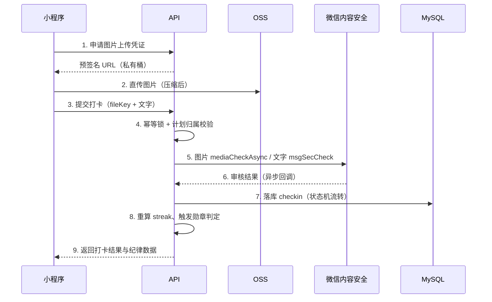

---

## 4. 角色与权限矩阵

| 角色 | 说明 | 权限范围 |
| --- | --- | --- |
| 游客 | 未授权微信 | 仅可浏览挑战计划列表与首页文案，不可打卡、不可评论 |
| 注册用户 | 已微信授权 | 创建计划、打卡、查看榜单、参与打卡圈与挑战、查看个人勋章、使用补卡券补卡、看广告领券 |
| 内容审核员 | 后台运营岗 | 打卡人审、评论人审、举报处理；无用户删除权限 |
| 运营管理员 | 后台运营岗 | 审核员全部权限 + 标签管理 + 挑战计划 + 勋章 + 排名配置 + 补卡券发放与奖励规则配置 + 邀请奖励配置 |
| 系统管理员 | 技术/老板 | 全部权限 + 用户管理 + 管理员与角色 + 操作日志（含 6.13 日志审计查询） |

> **审计日志的查询权限单独收口**：仅"系统管理员"与"审计员"两个角色可访问 `audit:query`；运营与审核员一律不可见。且**查询行为本身也要写入审计日志**（`AUDIT_QUERY`），防止内部人员滥用。

权限点编码规范：`模块:动作`，如 `user:disable`、`checkin:audit`、`challenge:publish`、`badge:grant`、`card:grant`、`card:rule`、`invite:invalidate`。

---

## 5. 用户端功能需求

### 5.1 微信授权登录（FR-5.1）

| 编号 | 需求 | 优先级 | 验收要点 |
| --- | --- | --- | --- |
| FR-5.1.1 | 首次进入展示首页与语录，点击"开始有恒"触发微信授权 | P0 | 未授权不可进入打卡流程，可浏览挑战列表 |
| FR-5.1.2 | 通过 `wx.login` 获取 code，后端 `code2Session` 换取 openid/unionid，静默注册 | P0 | openid 唯一，重复登录不重复建号 |
| FR-5.1.3 | 昵称头像通过 `chooseAvatar` + `input type=nickname` 采集，不使用已下线的 `getUserProfile` | P0 | 用户可跳过，系统生成默认昵称"有恒用户 8F3A" |
| FR-5.1.4 | 首次使用弹出《用户协议》《隐私政策》勾选确认，未勾选不可继续 | P0 | 勾选记录入库（版本号 + 时间） |
| FR-5.1.5 | 账号被禁用时，登录返回明确提示与申诉入口 | P0 | 禁用用户无法调用任何写接口（403） |
| FR-5.1.6 | 支持一键注销账号（二次确认 + 7 天冷静期） | P1 | 注销后 openid 解绑，数据按合规要求处理 |

### 5.2 创建与上传打卡计划（FR-5.2）

用户口中"上传打卡计划"，产品化为"新建计划"，字段如下：

| 字段 | 类型 | 必填 | 规则 |
| --- | --- | --- | --- |
| 计划名称 | 文本 | 是 | 2~20 字，过文字安全校验，禁用违规词 |
| 计划描述 | 文本 | 否 | ≤ 200 字，过文字安全校验 |
| 打卡标签 | 多选 | 是 | 1~3 个，只能从平台字典中选择，不支持自定义 |
| 目标天数 | 数字 | 是 | 7 / 21 / 30 / 66 / 100 / 365 / 自定义（1~3650） |
| 频率 | 枚举 | 是 | 每日一次 / 每周 N 次（N=1~6） |
| 开始日期 | 日期 | 是 | 默认今天，可选未来 7 天内 |
| 每日打卡时段 | 时间区间 | 否 | 用于提醒推送，默认 08:00 |
| 是否同步打卡圈 | 布尔 | 是 | 默认开启；关闭后内容仅自己可见 |
| 是否公开参与排名 | 布尔 | 是 | 默认开启；关闭后不进榜单 |
| 封面图 | 图片 | 否 | 1 张，≤2MB |
| 是否允许被邀请同行 | 布尔 | 是 | 默认开启；关闭后他人无法复制该计划（见 5.10） |
| 同行可见范围 | 枚举 | 是 | 仅同伴可见进度 / 公开到打卡圈 |

| 编号 | 需求 | 优先级 | 验收要点 |
| --- | --- | --- | --- |
| FR-5.2.1 | 创建计划时自动计算"计划周期"与"应打卡日集合" | P0 | 每日频率周期 = 目标天数；每周 N 次按自然周折算（周期 = 目标次数 ÷ N 向上取整周） |
| FR-5.2.2 | 天数为**后台自动计算**，用户不可直接改总天数 | P0 | 前端只展示计算结果，传参以服务端计算为准 |
| FR-5.2.3 | 同一用户最多同时进行 20 个计划 | P0 | 超限提示"先完成或归档一个计划" |
| FR-5.2.4 | 计划支持编辑（仅名称/描述/提醒时间/可见性），标签与频率创建后不可改 | P0 | 已产生打卡后改频率需二次确认并重算进度 |
| FR-5.2.5 | 计划支持归档、删除（逻辑删除） | P1 | 删除后榜单与打卡圈内容同步下架 |
| FR-5.2.6 | 计划详情支持"邀请好友同行"，生成该计划的邀请卡 | P0 | 关闭"允许被邀请"时隐藏入口（见 5.10.2） |
| FR-5.2.7 | 计划可被他人一键复制为同款计划（独立进度） | P0 | 复制后与原计划互为"同行"，互见连续天数 |

### 5.3 打卡（FR-5.3）

| 编号 | 需求 | 优先级 | 验收要点 |
| --- | --- | --- | --- |
| FR-5.3.1 | 打卡必传 **1~3 张图片**，支持拍照与相册 | P0 | 单张 ≤10MB，前端压缩至长边 1280px、≤500KB 后直传 OSS |
| FR-5.3.2 | 打卡文字可选，≤ 200 字 | P0 | 超长截断提示；提交前本地敏感词轻提示 |
| FR-5.3.3 | 同一计划同一自然日仅允许一次有效打卡 | P0 | 服务端幂等锁 + 唯一索引双保险，重复提交返回已打卡 |
| FR-5.3.4 | 提交后进入机审：图片异步、文字同步 | P0 | 机审结果 ≤ 5 秒返回；未出结果前状态为"审核中"，不显示在圈子与榜单 |
| FR-5.3.5 | 机审疑似（低置信度）进入人审队列，24 小时内出结果 | P0 | 超时未审自动置为"通过"并打标，便于事后抽查 |
| FR-5.3.6 | 机审驳回时展示具体原因类别（涉黄/涉政/广告/无相关内容/重复图片）与申诉入口 | P0 | 驳回不消耗当日打卡机会，可重新提交 |
| FR-5.3.7 | 打卡成功后立即刷新"坚持纪律"卡片并播放一次轻动效（≤300ms） | P0 | 不遮挡页面，不自动弹窗 |
| FR-5.3.8 | 支持对过去 7 天内缺失的日期补卡，消耗 1 张**补卡券**（见 5.9） | P0 | 无券不可补；补卡日计入连续但不计入勋章与挑战进度 |
| FR-5.3.9 | 打卡可附带位置（城市级），默认关闭 | P2 | 需授权，仅展示城市不展示经纬度 |

### 5.4 坚持纪律（FR-5.4）

「坚持纪律」是计划详情页的数据看板，展示 6 项指标：

| 指标 | 计算口径 | 展示形式 |
| --- | --- | --- |
| 当前连续 | 见 7.2 算法 | 大号数字 + 火焰/链条图标 |
| 最长连续 | 历史最大连续天数 | 次要数字 |
| 累计打卡 | 有效打卡总次数 | 数字 |
| 完成率 | 累计打卡 ÷ 应打卡日数 | 百分比 + 进度条 |
| 平均间隔 | 见 7.3 口径 | "平均每 X 天一次" |
| 纪律评级 | S/A/B/C/D 五档（见 7.4） | 徽标 + 一句话评语 |

| 编号 | 需求 | 优先级 | 验收要点 |
| --- | --- | --- | --- |
| FR-5.4.1 | 纪律卡片支持生成分享图（含连续天数、评级、语录） | P1 | 尺寸 750×1000，右下角带小程序码 |
| FR-5.4.2 | 连续天数达 7/21/30/66/100/365 时展示达标提示条 | P0 | 提示条可关闭，不打断打卡 |
| FR-5.4.3 | 断签次日进入计划页时展示"已断签"提示与复活方式 | P0 | 提示含补救入口（补签/重新开始） |

### 5.5 标签排名（FR-5.5）

| 编号 | 需求 | 优先级 | 验收要点 |
| --- | --- | --- | --- |
| FR-5.5.1 | 按标签查看排行榜，支持周榜/月榜/总榜切换 | P0 | 默认周榜，周一起算 |
| FR-5.5.2 | 榜单展示 Top 100（昵称、头像、连续天数、累计打卡、名次） | P0 | 第 101 名起仅展示"你已超过 XX% 的用户" |
| FR-5.5.3 | 展示"我的排名"悬浮条，含名次与前后名差距 | P0 | 未上榜时展示距离上榜还差多少天 |
| FR-5.5.4 | 用户可将某计划设为不参与排名，设置后立即从榜单移除 | P0 | 操作后 5 分钟内生效（缓存重建） |
| FR-5.5.5 | 榜单支持点击头像进入他人公开主页（仅展示公开计划与勋章） | P1 | 私密计划不出现在任何对外页面 |
| FR-5.5.6 | 同一用户多计划命中同一标签时，取该标签下连续天数最高的计划计入 | P0 | 一人一标签一条记录，防止霸榜 |

### 5.6 打卡圈（FR-5.6）

| 编号 | 需求 | 优先级 | 验收要点 |
| --- | --- | --- | --- |
| FR-5.6.1 | 信息流展示"同步到打卡圈"且审核通过的打卡，按发布时间倒序 | P0 | 支持按标签筛选、按热度排序（点赞+评论加权） |
| FR-5.6.2 | 支持点赞（可取消）与评论（≤ 100 字） | P0 | 点赞幂等，重复点赞不重复计数 |
| FR-5.6.3 | 评论支持回复（二级），不支持图片评论 | P1 | 二级以上回复平铺展示并 @ 被回复人 |
| FR-5.6.4 | 支持举报帖子与评论（涉黄/广告/辱骂/虚假） | P0 | 举报进入后台队列，24 小时内处理 |
| FR-5.6.5 | 内容发布者与管理员可删除自己的内容 | P0 | 删除为逻辑删除，保留审计痕迹 |
| FR-5.6.6 | 被拉黑用户不可评论/点赞该作者内容 | P1 | 拉黑关系单向生效 |

### 5.7 挑战计划（FR-5.7）

| 编号 | 需求 | 优先级 | 验收要点 |
| --- | --- | --- | --- |
| FR-5.7.1 | 挑战列表分三个 Tab：可参加 / 已参加 / 已结束 | P0 | 已结束指"结束时间已过"或"用户已完成" |
| FR-5.7.2 | 挑战详情展示：规则说明、时间窗口、目标次数、参与人数、完成人数、关联勋章、参与人动态 | P0 | 规则文案必须与系统判定口径一致（见 7.5） |
| FR-5.7.3 | 一键报名，报名后生成个人进度条 | P0 | 报名幂等；达上限后展示"名额已满" |
| FR-5.7.4 | 报名后产生的有效打卡自动计入该挑战，无需二次提交 | P0 | 打卡标签需与挑战要求标签匹配 |
| FR-5.7.5 | 完成时即时结算并弹出勋章获得动效，同时写入消息中心 | P0 | 结算延迟 ≤ 1 分钟（事件触发）/ ≤ 5 分钟（定时兜底） |
| FR-5.7.6 | 支持取消报名（开始后不可取消） | P1 | 取消后进度清零，勋章不可得 |
| FR-5.7.7 | 挑战详情支持"邀请好友一起参加"，生成带挑战 ID 的邀请卡 | P0 | 被邀请人报名后计为一次有效邀请（见 5.10.2） |
| FR-5.7.8 | 挑战详情展示"好友参与"（仅自己可见好友关系） | P1 | 无好友关系时展示邀请入口 |

### 5.8 个人中心（FR-5.8）

| 编号 | 需求 | 优先级 | 验收要点 |
| --- | --- | --- | --- |
| FR-5.8.1 | 我的勋章墙：已获得（高亮）/未获得（灰显 + 达成条件） | P0 | 支持按稀有度、类型筛选 |
| FR-5.8.2 | 我的计划：进行中 / 已完成 / 已归档 | P0 | 展示每个计划的连续天数与完成率 |
| FR-5.8.3 | 我的打卡日历（月视图，有记录打点） | P1 | 点击某日可查看当日打卡详情 |
| FR-5.8.4 | 我的挑战：进行中 / 已完成 / 已结束 | P0 | 与 5.7 数据同源 |
| FR-5.8.5 | 消息中心：审核结果、勋章获得、挑战结算、系统通知 | P0 | 未读数角标，支持全部已读 |
| FR-5.8.6 | 设置：提醒开关、隐私设置、协议、意见反馈、注销 | P0 | 提醒走订阅消息授权 |
| FR-5.8.7 | 券包入口：展示补卡券余额与临期提醒 | P0 | 余额 ≥1 时显示角标 |
| FR-5.8.8 | 邀请入口：展示"邀请好友"，含已邀请人数与累计奖励 | P0 | 进入 `pages/invite/index`（见 5.10） |

### 5.9 补卡券与奖励机制（FR-5.9）

「补卡券」是用户唯一可消耗的道具，用于修复断签。余额变动必须走账本流水，禁止任何直接改余额的写操作。

#### 5.9.1 补卡券规则

| 项 | 规则 |
| --- | --- |
| 单次消耗 | 补 1 个自然日消耗 1 张 |
| 可补范围 | 仅限过去 **7 天内**、且该日无有效打卡的日期 |
| 持有上限 | 最多 10 张，超出不可领取（提示"券包已满"） |
| 有效期 | 自发放起 **30 天**，到期自动失效，不可续期、不可补发 |
| 计划限制 | 单个计划单个自然月最多使用 4 张 |
| 消耗顺序 | 按到期时间先进先出（FEFO） |
| 转让交易 | 禁止 |
| 退券 | 补卡提交后被审核驳回，自动原路退回并恢复原有效期 |
| 计入口径 | 计入连续天数；**不计入**勋章进度与挑战进度（见 7.2.3、7.5） |

#### 5.9.2 获取途径

| 途径 | 数量 | 频率限制 | 优先级 | 说明 |
| --- | --- | --- | --- | --- |
| 完成挑战计划 | 1~3 张（按挑战配置） | 每挑战 1 次 | P0 | 结算时自动到账，无需手动领取 |
| 连续打卡里程碑 | 1 张 | 30 / 100 / 365 天各 1 次 | P0 | 与勋章同时发放，站内信通知 |
| 观看激励视频广告 | 1 张 | 每日 2 次 | P1 | 需开通流量主，见 5.9.3 |
| 运营手动发放 | 任意 | 人工 | P1 | 客服补偿、活动发放 |
| 邀请好友注册 | 1 张 | 每日 3 次 / 每月 20 次 | P0 | 被邀请人完成首次打卡后发放，见 5.10 |
| 邀请好友参加挑战 / 复制计划 | 1 张 | 每日 3 次（与上一行合并计算） | P1 | 被邀请人报名或复制成功后发放 |
| 分享到朋友圈 | —— | —— | P2 | **默认关闭**，见下方合规说明 |

> **合规红线（必须遵守）**
>
> 微信《小程序运营规范》第 5.1 条明确禁止"分享后可获得奖励"类诱导分享，处罚包括限制分享能力、封禁、提审驳回。因此：
>
> 1. 小程序页面**无法直接分享到朋友圈**，技术上只能生成海报图片由用户自行保存发布，平台**无法校验是否真的发布**；
> 2. 即使以"点击分享按钮"作为触发条件发放权益，仍构成诱导分享；
> 3. 结论：**"分享"只做功能（生成海报、转发给好友），不与任何奖励挂钩**。若必须激励传播，改用 5.9.2 表格中前三项（挑战/里程碑/广告）——这三类平台允许。
>
> 需求方原话"分享到朋友圈可领取"已按合规要求降级为 P2 且默认关闭，需产品与法务共同确认后方可开启；若坚持开启，须在提审前评估封禁风险。

#### 5.9.3 看广告领取补卡券（P1）

| 项 | 规则 |
| --- | --- |
| 广告类型 | 微信流量主「激励视频广告」（RewardedVideoAd） |
| 开通条件 | 小程序累计独立访客 ≥ 1000 且已开通流量主 |
| 入口 | 券包页 / 补卡页的"看广告领 1 张" |
| 完播判定 | 客户端 `onClose` 回调 `isEnded === true`；服务端复核每日次数与设备频次 |
| 频次 | 每日 2 次，每次 1 张，次日 00:00 重置（Asia/Shanghai） |
| 失败兜底 | 广告加载失败不扣任何权益；完播但领取请求失败，允许用同一幂等键重试 |
| 反作弊 | 同一 openid / 同设备每日超限拦截；1 小时内请求 > 5 次进风控名单并告警 |
| 降级 | 流量主未开通或广告位关闭时，入口隐藏，不展示空页面 |

#### 5.9.4 功能要求

| 编号 | 需求 | 优先级 | 验收要点 |
| --- | --- | --- | --- |
| FR-5.9.1 | 券包页：余额、临期券、获取入口、收支明细 | P0 | 余额与账本流水一致，前端不可篡改 |
| FR-5.9.2 | 补卡时校验余额、可补范围、计划月限额 | P0 | 不满足时给出具体原因与获取引导 |
| FR-5.9.3 | 完成挑战自动发券并推送站内信 | P0 | 发放幂等，重复结算不重复发放 |
| FR-5.9.4 | 看广告领券，完播后调用领取接口 | P1 | 每日上限 2 张，超限提示"明天再来" |
| FR-5.9.5 | 券到期前 3 天提醒 | P2 | 站内信 + 消息中心 |
| FR-5.9.6 | 收支明细可查（近 90 天，含来源与时间） | P0 | 每笔可追溯到具体挑战/广告/订单 |

### 5.10 邀请体系（FR-5.10）

邀请是 V1.3 新增的拉新与社交增长模块，包含三条独立链路：**邀请注册**、**邀请参加挑战**、**邀请参加（复制）我的计划**。

#### 5.10.1 三类邀请的差异

| 类型 | 发起人 | 被邀请人 | 落地页 | 成功后产生 |
| --- | --- | --- | --- | --- |
| `INVITE_REG` 邀请注册 | 任意已注册用户 | **未注册**的微信用户 | 邀请落地页 → 授权登录 | 绑定邀请关系；双方各得 1 张补卡券 |
| `INVITE_CHALLENGE` 邀请参加挑战 | 已报名某挑战的用户 | 任意用户（含未注册） | 挑战详情页（带 challengeId） | 被邀请人报名成功 → 邀请人得 1 张券 |
| `INVITE_PLAN` 邀请参加我的计划 | 计划创建者 | 任意用户 | 计划预览页 → 一键复制 | 生成同行关系（独立进度）；邀请人得 1 张券 |

#### 5.10.2 邀请标识与入口

| 项 | 规则 |
| --- | --- |
| 邀请人短码 | 6 位，字符集 `23456789ABCDEFGHJKLMNPQRSTUVWXYZ`（剔除 0/O/1/I/L 等易混字符），全局唯一，注册时生成 |
| 分享路径 | `pages/invite/landing?c=<code>&t=<type>&i=<id>`，其中 `type` 取 `reg`、`challenge`、`plan` 三者之一 |
| 小程序码 | 调 `wxacode.getUnlimited`，`scene` = `c=<code>&t=<type>&i=<id>`，**scene 总长 ≤ 32 字符**，页面固定 `pages/invite/landing` |
| 分享卡片 | `onShareAppMessage` 携带 `c`/`t`/`i` 参数，标题模板见 12.3 |
| 入口位置 | ① 个人中心「邀请好友」；② 挑战详情「邀请一起参加」；③ 计划详情「邀请同行」；④ 打卡成功页（仅提示，不强制） |
| 邀请码有效期 | 长期有效，可随时重新生成海报 |

> **技术约束**：`scene` 最多 32 字符且**不支持中文**，所以只能放短码与数字 ID；`i` 为数字 ID，`c` 为 6 位码，`t` 为单字母（r/c/p），实测总长 ≤ 32。落地页需在 `onLoad` 里兼容 `options.scene`（需 `decodeURIComponent`）与 `options.query` 两种来源。

#### 5.10.3 邀请关系绑定规则

| 规则 | 说明 |
| --- | --- |
| 一次性 | 一个用户终身只能绑定一个邀请人，绑定后**不可换绑、不可解绑** |
| 不能自邀 | 邀请码属于自己时直接忽略，不报错 |
| 设备去重 | 同一设备（`device_id`）已注册过账号的，新账号不计入有效邀请 |
| 时效 | 点击邀请卡后 30 天内完成注册仍可归因；超期失效 |
| 归因优先级 | 首次进入携带的邀请参数 > 本地缓存的 pending 邀请 > 无 |
| 冲突 | 已绑定过的老用户再次点别人的邀请卡 → 只走"参加挑战/复制计划"，**不改变邀请关系** |

#### 5.10.4 奖励与服务端判定

| 场景 | 邀请人 | 被邀请人 | 发放时机 |
| --- | --- | --- | --- |
| 邀请注册 | +1 张补卡券 | +1 张补卡券 | 被邀请人**完成首次有效打卡**后（防止注册即走） |
| 邀请参加挑战 | +1 张补卡券 | — | 被邀请人报名成功且完成首次打卡 |
| 邀请参加计划 | +1 张补卡券 | — | 被邀请人复制计划成功 |
| 被邀请人 7 天内零打卡 | 0（不发放） | +1 张仍发放 | 只保证新用户冷启动，不惩罚邀请人以外的环节 |

**频次限制**：邀请人每日最多 3 次邀请奖励、每月最多 20 次；被邀请人终身只能作为"被邀请人"获得一次奖励。

**与补卡券体系的关系**：奖励统一走 7.8 的 `grantCard()`，规则码 `REWARD_INVITE_REG` / `REWARD_INVITE_CHALLENGE` / `REWARD_INVITE_PLAN`，幂等键为 `invite_record_id`，因此重复回调不会重复发券。

#### 5.10.5 合规红线（与 5.9.2 同级）

> 微信《小程序运营规范》第 5.9 条禁止**多级分销**，第 5.1 条禁止**诱导分享**。邀请体系必须满足：
>
> 1. **只做一级**：A 邀请 B，B 再邀请 C 时，A 与 C **无任何关系**，A 不因 C 获得任何奖励；
> 2. **不按人头计酬**：不得出现"团队人数 × 固定金额""下级消费返佣"等结构；
> 3. **奖励仅虚拟道具**：补卡券不可转让、不可提现、无现金等价物；
> 4. **文案中性**：用"邀请好友一起有恒""一起坚持"，禁止"邀请得奖励""拉新返现""躺赚"；
> 5. **不强制分享**：分享是可选动作，不分享不影响任何核心功能（打卡、看榜、补卡）。

#### 5.10.6 功能要求

| 编号 | 需求 | 优先级 | 验收要点 |
| --- | --- | --- | --- |
| FR-5.10.1 | 个人中心「邀请好友」页：邀请卡预览、保存海报、分享给好友、复制邀请码 | P0 | 海报含语录、邀请人昵称、小程序码、邀请码 |
| FR-5.10.2 | 挑战详情、计划详情各自的邀请入口，携带对应 `t` 与 `i` | P0 | 未开启邀请的计划不显示入口 |
| FR-5.10.3 | 落地页：展示邀请人昵称/头像、被邀请的内容（挑战规则或计划概要）、一键接受按钮 | P0 | 未注册先授权，注册后自动执行接受动作 |
| FR-5.10.4 | 一键接受：注册（如需）→ 绑定关系 → 报名挑战 / 复制计划 | P0 | 全程 ≤ 3 步，不要求填写任何表单 |
| FR-5.10.5 | 我的邀请记录：已邀请人数、获得的券、每条记录的状态与时间 | P0 | 状态含待完成/已绑定/已发放/已失效 |
| FR-5.10.6 | 同行关系：我与同伴互见连续天数与完成率 | P1 | 默认仅同伴可见，可在计划设置中关闭 |
| FR-5.10.7 | 邀请数据看板（个人维度）：本周邀请数、累计奖励 | P2 | — |

---

## 6. 后台管理功能需求

后台采用统一布局：左侧菜单 + 顶部面包屑 + 内容区表格。所有列表支持关键词搜索、条件筛选、分页（默认 20 条/页）、导出 Excel（P1）。**所有写操作记录操作日志**（操作人、时间、IP、前后值摘要）。

### 6.1 用户管理（FR-6.1）

| 编号 | 需求 | 优先级 | 验收要点 |
| --- | --- | --- | --- |
| FR-6.1.1 | 用户列表：昵称、openid、手机号（如有）、注册时间、最后登录、计划数、打卡数、状态 | P0 | 支持按昵称/openid/状态/注册时间区间筛选 |
| FR-6.1.2 | 新增用户（仅内部测试用，手工造号） | P1 | 需填写 openid 与昵称，重复 openid 拒绝 |
| FR-6.1.3 | 编辑用户：昵称、头像、状态、备注 | P0 | openid 不可修改 |
| FR-6.1.4 | 启用 / 禁用（支持批量） | P0 | 禁用需填写原因；禁用后立即踢下线（JWT 加入黑名单） |
| FR-6.1.5 | 删除用户（逻辑删除，二次确认 + 输入昵称确认） | P0 | 关联打卡与评论同步隐藏，不可物理删除 |
| FR-6.1.6 | 用户详情：基本信息 + 计划列表 + 打卡列表 + 勋章列表 + 违规记录 | P0 | 支持跳转到对应打卡记录 |
| FR-6.1.7 | 重置用户登录态（强制重新授权） | P2 | — |

### 6.2 打卡标签管理（FR-6.2）

| 编号 | 需求 | 优先级 | 验收要点 |
| --- | --- | --- | --- |
| FR-6.2.1 | 标签列表：名称、图标、排序、颜色、状态、使用计划数 | P0 | 支持拖拽排序 |
| FR-6.2.2 | 新增 / 编辑标签：名称（≤6 字，唯一）、图标、主色、是否开放排名 | P0 | 名称重复校验（含已删除） |
| FR-6.2.3 | 启用 / 停用标签 | P0 | 停用后不可再被选择，历史数据保留并在展示层降级为"其他" |
| FR-6.2.4 | 删除标签（仅当使用计划数为 0） | P1 | 有引用时提示先迁移 |
| FR-6.2.5 | 初始标签：健身、学习、跑步、篮球、单词计划、睡眠、早餐（见附录 A） | P0 | 随 Flyway 初始化脚本导入 |

### 6.3 打卡管理（FR-6.3）

| 编号 | 需求 | 优先级 | 验收要点 |
| --- | --- | --- | --- |
| FR-6.3.1 | 打卡列表：图片缩略图、用户、计划、标签、正文、机审结果、状态、时间 | P0 | 支持按状态（待审/通过/驳回/下架）、标签、时间区间筛选 |
| FR-6.3.2 | 待审队列为审核员默认首页，按提交时间正序（先到先审） | P0 | 支持键盘快捷键（A 通过 / D 驳回 / ← → 切图） |
| FR-6.3.3 | 人工审核操作：通过（发布）、驳回（选择原因 + 备注）、下架（已发布内容） | P0 | 驳回原因必选，备注 ≥ 5 字（驳回时必填） |
| FR-6.3.4 | 驳回后可通知用户，用户可申诉一次，申诉进入"申诉队列" | P0 | 申诉由不同审核员处理（避免自审自） |
| FR-6.3.5 | 批量操作：批量通过（仅限机审高置信度通过项） | P1 | 单次最多 50 条 |
| FR-6.3.6 | 审核记录留痕：审核人、时间、动作、原因、耗时 | P0 | 可追溯，用于质检抽检 |
| FR-6.3.7 | 审核统计：审核员日处理量、平均耗时、驳回率、申诉改判率 | P1 | 后台"审核质检"页展示 |

### 6.4 排名管理（FR-6.4）

| 编号 | 需求 | 优先级 | 验收要点 |
| --- | --- | --- | --- |
| FR-6.4.1 | 榜单配置：每个标签选择排名维度（连续天数/累计打卡/完成率）与周期（周/月/总） | P0 | 同一标签可配置多周期，互相独立 |
| FR-6.4.2 | 榜单查看：按标签 + 周期查看实时榜单与快照榜 | P0 | 支持切换"实时"与"上一周期结果" |
| FR-6.4.3 | 异常剔除：手工将某用户在某标签榜移除，填写原因 | P0 | 移除记录留痕，可恢复 |
| FR-6.4.4 | 禁榜管理：对作弊账号设置禁榜 N 天 | P0 | 禁榜期间打卡照常，不进榜 |
| FR-6.4.5 | 榜单刷新：支持手动触发重建（指定标签 + 周期） | P0 | 重建任务异步执行，展示进度 |
| FR-6.4.6 | 榜单规则说明页（用户可见），与配置联动 | P1 | 文案随配置自动生成 |

### 6.5 评论管理（FR-6.5）

| 编号 | 需求 | 优先级 | 验收要点 |
| --- | --- | --- | --- |
| FR-6.5.1 | 评论列表：内容、评论人、被评内容、点赞数、状态、时间 | P0 | 支持按关键词、状态、时间筛选 |
| FR-6.5.2 | 审核 / 隐藏 / 删除评论 | P0 | 删除为逻辑删除，前台立即消失 |
| FR-6.5.3 | 被举报评论优先置顶展示 | P0 | 举报队列与审核队列联动 |
| FR-6.5.4 | 评论敏感词库维护（命中即自动隐藏） | P1 | 词库支持导入、启用/停用 |
| FR-6.5.5 | 用户评论权限封禁（禁言 N 天） | P1 | 禁言原因与时长入库 |

### 6.6 打卡圈管理（FR-6.6）

| 编号 | 需求 | 优先级 | 验收要点 |
| --- | --- | --- | --- |
| FR-6.6.1 | 圈子动态列表：内容、作者、点赞/评论数、状态（正常/隐藏/下架） | P0 | 支持按标签、热度、时间筛选 |
| FR-6.6.2 | 置顶 / 取消置顶指定动态 | P1 | 每个标签最多置顶 3 条 |
| FR-6.6.3 | 隐藏 / 下架动态（含批量） | P0 | 下架需选原因，同步扣减对应计数 |
| FR-6.6.4 | 圈子话题管理：话题名称、封面、关联标签、状态 | P2 | 用于 V1.1 内容运营 |
| FR-6.6.5 | 举报处理：举报列表 → 查看内容 → 判定（成立/不成立）→ 处置 | P0 | 处理时限 24 小时，超时标红 |

### 6.7 挑战计划管理（FR-6.7）

| 编号 | 需求 | 优先级 | 验收要点 |
| --- | --- | --- | --- |
| FR-6.7.1 | 创建挑战：标题、封面、规则类型、时间窗口、目标次数/天数、单次标准、关联标签、关联勋章、名额上限 | P0 | 规则类型见 7.5，字段联动校验 |
| FR-6.7.2 | 预览"规则文案"自动生成，运营可微调但不能与判定口径冲突 | P0 | 发布前必须预览确认 |
| FR-6.7.3 | 草稿 → 待发布 → 进行中 → 已结束 → 已结算 | P0 | 状态不可逆（已结算不可回退） |
| FR-6.7.4 | 已参加人数 / 完成人数实时展示，支持查看参与名单与个人进度 | P0 | 名单支持导出 |
| FR-6.7.5 | 手动结算与重算（异常修复） | P0 | 重算需超管权限，生成差异报告 |
| FR-6.7.6 | 提前终止挑战：退款/补偿策略、勋章是否仍颁发可配置 | P1 | 终止需填写公告文案并推送给参与者 |
| FR-6.7.7 | 挑战排行榜（按完成时间/进度） | P1 | 与标签榜独立 |

### 6.8 勋章管理（FR-6.8）

| 编号 | 需求 | 优先级 | 验收要点 |
| --- | --- | --- | --- |
| FR-6.8.1 | 勋章列表：名称、图标、稀有度、类型（里程碑/挑战/特殊）、达成条件、持有人数 | P0 | 支持按类型、状态筛选 |
| FR-6.8.2 | 新增 / 编辑勋章：名称、图标、稀有度、条件类型与阈值、有效期 | P0 | 阈值修改仅影响后续判定，不追溯已发勋章 |
| FR-6.8.3 | 关联挑战计划：一个挑战对应 1 枚勋章，一枚勋章可被多个挑战复用 | P0 | 关联关系在挑战侧配置，勋章侧只读展示 |
| FR-6.8.4 | 颁发记录：用户、勋章、来源（自动/手动）、时间 | P0 | 支持按用户/勋章查询 |
| FR-6.8.5 | 手动补发 / 撤销勋章（撤销需原因与超管审批） | P0 | 撤销后用户端灰显并提示"已撤销" |
| FR-6.8.6 | 勋章排序与展示位配置（个人页前 5 枚） | P1 | — |

### 6.9 数据统计（FR-6.9）

时间维度：**当日 / 近 7 天 / 近 30 天 / 近 180 天**（支持自定义区间，P1）。

| 编号 | 指标 | 口径 | 优先级 |
| --- | --- | --- | --- |
| FR-6.9.1 | 注册用户数 | 区间内新注册去重用户数 | P0 |
| FR-6.9.2 | 在线用户数 | 近 5 分钟内有用有效请求的去重用户数（Redis 5 分钟滑动窗口，按分钟 bitmap 存储） | P0 |
| FR-6.9.3 | 活跃用户数（DAU/WAU/MAU） | 当日有打卡或评论行为 | P0 |
| FR-6.9.4 | 打卡数 / 打卡人数 | 状态为"通过"的打卡 | P0 |
| FR-6.9.5 | 计划创建数 / 完成数 | — | P0 |
| FR-6.9.6 | 挑战参与数 / 完成数 / 完成率 | — | P0 |
| FR-6.9.7 | 勋章颁发数（按勋章 Top 10） | — | P1 |
| FR-6.9.8 | 审核量 / 通过率 / 平均审核时长 | 机审 + 人审分开统计 | P1 |
| FR-6.9.9 | 留存曲线（次日/7 日/30 日） | 按注册日分群 | P1 |
| FR-6.9.10 | 内容举报量 / 成立率 | — | P2 |

| 编号 | 需求 | 优先级 | 验收要点 |
| --- | --- | --- | --- |
| FR-6.9.11 | 首页概览卡片：今日注册、今日在线、今日打卡、待审数量 | P0 | 数据延迟 ≤ 5 分钟 |
| FR-6.9.12 | 趋势图：折线图展示所选区间的日维度趋势 | P0 | 支持导出 PNG |
| FR-6.9.13 | 统计口径说明可查看（悬浮提示） | P1 | 避免运营误读 |

### 6.10 补卡券与奖励管理（FR-6.10）

| 编号 | 需求 | 优先级 | 验收要点 |
| --- | --- | --- | --- |
| FR-6.10.1 | 券包查询：按 openid/昵称查余额、有效期、收支流水 | P0 | 余额与账本一致，异常时高亮 |
| FR-6.10.2 | 手动发放 / 回收补卡券 | P0 | 必填原因；单次上限 10 张；记操作日志 |
| FR-6.10.3 | 奖励规则配置：各途径开关、数量、每日上限、有效期（默认 30 天） | P0 | 保存后立即生效，缓存同步失效 |
| FR-6.10.4 | 广告位配置：激励视频开关、每日次数、风控阈值 | P1 | 关闭后小程序端隐藏入口 |
| FR-6.10.5 | 补卡券看板：发放量、消耗量、结存、人均持有、临期未用 | P1 | 按日维度，支持导出 |
| FR-6.10.6 | 账本对账：`user_card.balance` 与 `card_ledger` 汇总比对，不一致告警 | P1 | 每日 02:00 跑批，差异写入告警表 |
| FR-6.10.7 | 补卡记录：补卡人、计划、日期、消耗券、审核结果 | P0 | 支持导出，用于客服核对 |

### 6.11 邀请管理（FR-6.11）

| 编号 | 需求 | 优先级 | 验收要点 |
| --- | --- | --- | --- |
| FR-6.11.1 | 邀请码管理：查询任意用户的邀请码、重新生成、禁用 | P0 | 禁用后旧码失效，已绑定关系不受影响 |
| FR-6.11.2 | 邀请记录列表：邀请人、被邀请人、类型、目标（挑战/计划）、状态、时间、IP、设备 | P0 | 支持按类型、状态、时间区间、是否异常筛选 |
| FR-6.11.3 | 奖励配置：三类邀请的发放开关、张数、每日/每月上限 | P0 | 与补卡券规则共用一套配置（见 7.8） |
| FR-6.11.4 | 异常邀请处理：标记无效、批量作废、追回已发券 | P0 | 追回需超管权限，写反向账本 |
| FR-6.11.5 | 风控名单：同设备多账号、同 IP 批量注册、高频邀请的账号 | P0 | 命中名单的邀请不计入奖励 |
| FR-6.11.6 | 邀请数据看板：新增邀请数、转化率、K 因子、有效邀请 vs 无效邀请 | P1 | 按日/周维度，可导出 |
| FR-6.11.7 | 邀请关系树查询（仅用于风控排查，不对外） | P1 | **只展示一级**，不做多级归属计算 |

> 注意：邀请关系树仅用于排查同一设备/同一 IP 的异常团伙，**产品层面不存在二级及以上的奖励归属**，后台也不得提供"团队业绩"类报表（合规要求见 5.10.5）。

### 6.12 系统管理（FR-6.12）

| 编号 | 需求 | 优先级 |
| --- | --- | --- |
| FR-6.12.1 | 管理员账号管理（增删改查、重置密码、启停） | P0 |
| FR-6.12.2 | 角色与权限配置（菜单/按钮/接口） | P0 |
| FR-6.12.3 | 操作日志（管理员侧操作，已并入 6.13 日志审计统一管理） | P0 |
| FR-6.12.4 | 数据字典（审核原因、驳回原因、标签分类） | P0 |
| FR-6.12.5 | 敏感词库管理 | P1 |

### 6.13 日志审计管理（FR-6.13）

定位：**面向合规、客服与风控**的操作流水，与开发排障用的文本日志是两套东西（见 7.10）。覆盖**最终用户的每一次写操作**与后台管理员的每一次管理动作。

| 编号 | 需求 | 优先级 | 验收要点 |
| --- | --- | --- | --- |
| FR-6.13.1 | 日志列表：时间、操作者、动作、对象、结果、IP/地区、耗时、traceId | P0 | 默认近 7 天；时间范围必选，在线查询最长 90 天 |
| FR-6.13.2 | 多条件检索：操作者（openid/昵称）、动作编码、模块、结果、时间段、IP | P0 | 空条件拒绝查询，防止全表扫描 |
| FR-6.13.3 | 单条详情：动作、目标、before/after 差异、耗时、UA、版本、渠道、错误码 | P0 | 敏感字段脱敏；不返回明文 openid 与带签名的图片 URL |
| FR-6.13.4 | 用户行为时间线：按用户聚合近 24 小时 / 7 天操作 | P0 | 客服排障主入口，按时间正序 |
| FR-6.13.5 | 异常告警：批量失败、高频操作、异地登录、单日领券超限 | P0 | 告警可指派、可忽略（忽略必填原因） |
| FR-6.13.6 | 异步导出 Excel（按当前查询条件） | P1 | 单次 ≤ 10 万行；导出行为记入审计 |
| FR-6.13.7 | **只读不可改**：后台不提供编辑与删除入口 | P0 | DB 账号对审计表仅 `INSERT`/`SELECT`，无 `UPDATE`/`DELETE` |
| FR-6.13.8 | 查询留痕：谁在何时查了谁的日志 | P0 | 每次查询写 `AUDIT_QUERY`，含查询条件摘要 |
| FR-6.13.9 | 归档与回查：超期日志转冷存储，可按需导入回查 | P1 | 归档失败告警，回查 ≤ 10 分钟 |
| FR-6.13.10 | 关联跳转：从日志一键跳到对应打卡/挑战/券流水/邀请记录 | P1 | 目标不存在时给出明确提示 |

---

## 7. 核心业务规则

> 本章是开发与测试的唯一判定依据。任何口径冲突以本章为准。

### 7.1 "一天"的口径

1. 以 **服务器所在时区（Asia/Shanghai）的自然日 00:00:00 ~ 23:59:59** 为准，不做用户时区换算（目标用户均为国内）。
2. `checkin_date` 字段类型 `DATE`，由服务端根据 `create_time` 计算，**不接受前端传入**。
3. 跨零点提交（23:59:30 提交、00:00:10 到达）按服务端接收时间判定，并记录 `client_submit_time` 用于申诉核实。

### 7.2 连续天数（Streak）算法

```
输入：planId, 今日 D
1. 取该计划所有 status=PUBLISHED 的 checkin_date 集合 S（含补签日）
2. 若 D ∈ S：cursor = D；否则若 (D-1) ∈ S：cursor = D-1（今日未打卡不算断签，允许补打）；否则 streak = 0，结束
3. streak = 1；cursor -= 1 天
4. while cursor ∈ S：streak += 1；cursor -= 1 天
5. 若频率为"每周 N 次"，则按"自然周内次数达标"判定连续周数，再折算天数（见 7.2.2）
6. 输出 streak
```

**7.2.1 每日频率**：逐日回溯，断一天即断签。

**7.2.2 每周 N 次**：以自然周（周一至周日）为单元，周内有效打卡 ≥ N 次即视为该周达标；连续达标周数 × 7 为展示天数，并额外展示"已连续 X 周"。

**7.2.3 关键规则**

| 情形 | 判定 |
| --- | --- |
| 当日未打卡但昨日已打卡（当天 23:59 前） | 不断签，连续天数保持昨日值 |
| 昨日未打卡、前日已打卡 | 断签，streak 归零；若今日打卡则 streak = 1 |
| 审核中的打卡 | 不计入 streak，审核通过后回溯重算 |
| 被驳回的打卡 | 不计入；若该日无其他有效打卡则视为未打卡 |
| 补签的打卡 | 计入 streak，标记 `is_makeup=1`，不参与勋章进度 |
| 计划归档 / 删除 | 停止计算，冻结快照 |

### 7.3 平均与完成率口径

| 指标 | 公式 | 说明 |
| --- | --- | --- |
| 累计打卡 | `COUNT(checkin WHERE status=PUBLISHED)` | 含补签 |
| 应打卡日数 | 从 `start_date` 到 `min(今天, 计划结束日)` 的自然日数 | 每日频率；每周 N 次按 N/7 折算 |
| 完成率 | 累计打卡 ÷ 应打卡日数，封顶 100% | 展示保留 1 位小数 |
| 平均间隔 | 应打卡日数 ÷ 累计打卡（天/次） | 展示"平均每 X.X 天打卡一次"；分母为 0 时显示"—" |
| 平均连续长度 | 所有连续段长度之和 ÷ 连续段数 | 用于"平均坚持天数"榜（P1） |

> 需求方原话"平均多少天"存在两种理解：**平均间隔**与**平均连续长度**。V1.0 两个指标都保留，个人页默认展示"平均间隔"，榜单默认按"最长连续"排序，待运营确认后收敛为单一指标（见 15 章 Q3）。

### 7.4 纪律评级

| 评级 | 判定（满足任一） | 文案 |
| --- | --- | --- |
| S | 连续 ≥ 100 天，且近 30 天无断签、无补签 | 恒者无敌 |
| A | 连续 ≥ 30 天，且完成率 ≥ 90% | 已成习惯 |
| B | 连续 ≥ 7 天，且完成率 ≥ 70% | 渐入佳境 |
| C | 完成率 ≥ 40% | 尚在坚持 |
| D | 完成率 < 40% | 重新出发 |

评级每日凌晨由定时任务重算，写入 `plan_streak` 快照；用户打卡后即时重算当日评级。

### 7.5 挑战计划的规则模型（重点）

挑战计划抽象为两种规则类型，所有运营配置必须落在下列字段组合内：

| 字段 | 类型 | 说明 |
| --- | --- | --- |
| `rule_type` | COUNT / STREAK | 次数型 / 连续型 |
| `window_type` | FIXED / RELATIVE | 固定起止 / 报名后 N 天 |
| `window_days` | int | 相对型的时间窗口天数 |
| `target_count` | int | 目标次数（COUNT 型）或目标天数（STREAK 型） |
| `tag_id` | bigint | 必须命中的标签 |
| `per_time_standard` | varchar | 单次标准描述，如"单次 ≥ 10km" |
| `per_time_min_value` | decimal | 单次标准的数值下限（可选，用于自动校验） |

**示例：需求方给出的"半个月连续 10km 跑步 10 次"**

- 解析口径：`rule_type = COUNT`，`window_type = RELATIVE`，`window_days = 15`，`target_count = 10`，`tag_id = 跑步`，`per_time_standard = "单次跑步 ≥ 10km"`。
- 即：报名后 15 个自然日内，累计完成 10 次"跑步"标签下、单次 ≥10km 的有效打卡。
- 单次距离来源：用户在打卡时填写距离（P0），或上传运动 App 截图由人审确认（P1 OCR）。**V1.0 采用"用户填写 + 人审抽检"**，不承诺全自动识别。
- 文案必须写成："15 天内完成 10 次 10km 跑步"，**不写"连续 10 次"**，避免与 STREAK 型混淆。

| 编号 | 规则 | 说明 |
| --- | --- | --- |
| BR-7.5.1 | 挑战进度只统计 `status=PUBLISHED` 且标签匹配的打卡 | — |
| BR-7.5.2 | 补签打卡不计入挑战进度 | 防刷 |
| BR-7.5.3 | 一个打卡最多计入 3 个同时进行的挑战 | 防止一次打卡白嫖全部活动 |
| BR-7.5.4 | 完成判定：COUNT 型 `进度 ≥ target_count`；STREAK 型连续天数 `≥ target_count` | — |
| BR-7.5.5 | 时间窗口内未完成则置为"未完成"，不可续期 | 重开需新建挑战 |
| BR-7.5.6 | 完成后 5 分钟内自动颁发关联勋章，发站内信 | 定时任务兜底 |
| BR-7.5.7 | 挑战 medals 与里程碑勋章可叠加，同类勋章不重复颁发 | — |

### 7.6 排名算法

**排序键**（按标签配置的主维度，默认"当前连续天数"）：

```
score = 主维度值 × 10000 + 累计打卡天数 × 10 - 最近打卡距今天数
```

- 权重可配置，配置项落在 `rank_config` 表，修改后需重建 ZSET。
- 同分处理：主维度与次维度完全相同则**并列同名次**（如两人并列第 3，下一名为第 5）。
- 一人一标签一条：同一用户在同一标签下取"当前连续天数最高的计划"计入。
- 周期：周榜（周一 00:00 重置）按"本周新增有效打卡数"排；月榜同理；总榜按连续天数。
- 刷新：打卡通过事件触发增量更新 ZSET；每小时定时全量重建一次纠偏；每周期结束生成快照到 `rank_snapshot`。

**反作弊**

| 手段 | 说明 |
| --- | --- |
| 图片去重 | 对图片计算 pHash，全局查重；同一 pHash 出现在 ≥2 个账号下 → 标记可疑 |
| 打卡时间异常 | 连续多日打卡时间集中在同一秒级区间 → 标记 |
| 设备聚集 | 同设备/同 IP 下多账号互刷 → 标记 |
| 审核驳回扣分 | 每被驳回 1 次，榜单 score 扣减 5%，累计 3 次禁榜 7 天 |
| 人工剔除 | 后台排名管理手动移除 |

### 7.7 自动审核规则

**图片审核链路**

1. 上传前：前端压缩 + 格式白名单（jpg/png/webp），拒绝 HEIC。
2. 上传后：服务端校验文件头（防改后缀）、像素下限（≥ 300×300）、EXIF 剥离、计算 pHash 与 MD5。
3. 机审：调用微信 `mediaCheckAsync`（v2），异步回调结果；超时 30 秒未回调视为"待人审"。
4. 本地规则：pHash 全局去重（命中已有图片 → 疑似盗图）、纯色/纯黑图（像素方差过低 → 疑似无效图）。
5. 判定：
   - `PASS`（置信度 ≥ 0.9 且无本地规则命中）→ 直接发布。
   - `SUSPECT`（0.5~0.9 或命中本地规则）→ 人工复核。
   - `REJECT`（< 0.5 或命中涉黄涉政）→ 驳回，附原因。
6. 所有图片经过 CDN 或 OSS 私有读 + 预签名 URL（有效期 30 分钟），禁止公网直链。

**文字审核链路**

1. 同步调用 `msgSecCheck`（v2），场景值 `10`（评论）/ `30`（昵称）等按场景传。
2. 本地敏感词库（Aho-Corasick）二次过滤，命中高危词直接驳回。
3. 命中低危词 → 打标"含敏感词"，进人审队列。

**人审 SLA**：疑似内容 24 小时内出结果；超时自动通过并标记 `auto_passed`，进抽检池（抽检比例 10%）。

**违规处置**

| 违规级别 | 处置 |
| --- | --- |
| 轻微（广告、无关图） | 驳回 + 站内提醒 |
| 一般（低俗、辱骂） | 驳回 + 禁言 3 天 |
| 严重（涉黄涉政、违法） | 驳回 + 封号 + 保留证据 |

### 7.8 补卡券与奖励发放规则

**账本模型**：`card_ledger` 是唯一可信源，`user_card.balance` 只是冗余快照（乐观锁 `version`）。任何余额变动必须成对写入账本。

**发放伪代码**

```
function grantCard(userId, sourceType, sourceId, count):
    # 1. 幂等：同一来源只发一次
    if exists(card_ledger where user_id=userId
              and source_type=sourceType and source_id=sourceId):
        return ALREADY_GRANTED
    # 2. 持有上限
    if balanceOf(userId) + count > 10:
        return CARD_PACK_FULL
    # 3. 频次限制
    if countToday(userId, sourceType) + count > rule.dailyLimit:
        return DAILY_LIMIT_REACHED
    # 4. 写账本 + 更新快照（同一事务）
    ledger = insert(card_ledger, delta=+count,
                    expire_at = now() + 30 days, source_type, source_id)
    update user_card set balance = balance + count, version = version + 1
    # 5. 通知
    pushMessage(userId, "补卡券 +" + count)
```

**默认规则表（`reward_rule` 初始化数据）**

| 规则码 | 触发条件 | 发放数量 | 频率上限 | 来源标识 |
| --- | --- | --- | --- | --- |
| `REWARD_CHALLENGE` | 挑战结算完成 | 挑战配置 1~3 张 | 每挑战 1 次 | challenge_id |
| `REWARD_MILESTONE_30` | 单计划连续 30 天 | 1 | 每计划 1 次 | plan_id |
| `REWARD_MILESTONE_100` | 单计划连续 100 天 | 1 | 每计划 1 次 | plan_id |
| `REWARD_MILESTONE_365` | 单计划连续 365 天 | 1 | 每用户 1 次 | plan_id |
| `REWARD_AD` | 激励视频完播 | 1 | 每日 2 次 | 日期 + 序号 |
| `REWARD_ADMIN` | 后台手动 | 任意 | 无 | 操作单号 |
| `REWARD_SHARE` | 分享海报 | 0（默认关闭） | 无 | —— |

**消耗规则（补卡事务，5 步原子操作）**

1. 校验券余额 ≥ 1 且存在未过期券；
2. 校验目标日期在 [今天-7, 昨天] 区间、该日无有效打卡；
3. 校验该计划本月已用 < 4 张；
4. 写账本 `-1`（记录券实例 ID 与到期日），更新快照；
5. 写入 `checkin(is_makeup=1, status=已发布)` → 重算 streak → 触发评级更新。

任一步失败整事务回滚，券不扣减。补卡后若被人工驳回：写反向账本 `+1`，券恢复原到期日，并通知用户。

**边界规则**

| 场景 | 处理 |
| --- | --- |
| 券在补卡事务中被并发消耗 | 券实例加行锁（`SELECT ... FOR UPDATE`），失败返回 6001 |
| 券正好在 23:59 过期 | 以服务端时间为准，过期即不可用 |
| 补卡目标日本身已过期超过 7 天 | 拒绝，提示可补范围 |
| 同一日重复补卡 | 唯一索引拦截，返回 3001 |
| 用户券包已满又完成挑战 | 不发放，记录"待领取"，7 天内可手动领取（P2） |
| 挑战被终止 | 已发放券不回收 |

### 7.9 邀请关系与奖励判定

**归因（点击 → 注册）**

```
function onLanding(code, type, targetId, deviceId):
    inviter = findByCode(code)
    if inviter == null:            return NO_INVITE
    if inviter.isSelf(visitor):    return NO_INVITE       # 自邀
    if deviceHasRegistered(deviceId): return NO_INVITE    # 设备去重
    savePending(code, type, targetId, expireAt = now + 30d)

function onRegister(userId, deviceId, pending):
    if user.inviterId != null:     return ALREADY_BOUND   # 终身一次
    if pending == null or expired: return NO_INVITE
    record = insert(invite_record, inviterId, inviteeId=userId,
                    type, targetId, status=PENDING,
                    deviceId, ip, expireAt = now + 30d)
    user.inviterId = record.inviterId                     # 只写一次，不加锁重试
    return record
```

**状态机**：`PENDING`（已绑定待激活）→ `ACTIVATED`（被邀请人完成首次有效打卡）→ `REWARDED`（券已发）；分支 `EXPIRED`（30 天未激活）、`INVALID`（风控判定无效）。

**发放判定**

```
function tryReward(record):
    if record.status != ACTIVATED:                 return
    if !hasFirstValidCheckin(record.inviteeId):    return   # 必须真实打卡
    if overDailyLimit(inviter, 3):                 return   # 转"待发放"
    if overMonthlyLimit(inviter, 20):              return
    grantCard(inviter, REWARD_INVITE_<TYPE>, record.id, 1)
    if record.type == REG:
        grantCard(invitee, REWARD_INVITE_REG, record.id, 1)
    record.status = REWARDED
```

> `grantCard` 的幂等键是 `invite_record_id`，所以 `challengeSettleJob` 之类的定时任务重跑不会重复发券。

**风控矩阵**

| 特征 | 判定 | 处置 |
| --- | --- | --- |
| 同 `device_id` 下出现 ≥2 个新账号 | 疑似小号 | 第二个起不计入，记 `INVALID` |
| 同 IP 24 小时内 >3 个新账号 | 疑似批量注册 | 全部转人工复核，暂停发券 |
| 邀请人 1 小时内 >10 条邀请记录 | 异常高频 | 冻结奖励，进风控名单 |
| 被邀请人注册后 7 天零打卡 | 无效邀请 | 置 `EXPIRED`，不发券 |
| 被邀请人与邀请人同设备 | 自邀 | 直接忽略绑定，不报错 |

**边界规则**

| 场景 | 处理 |
| --- | --- |
| 已绑定用户再次点他人邀请卡 | 不改变邀请关系，仅执行报名/复制动作 |
| 同一被邀请人点了多个邀请卡 | 以首次点击为准，其余丢弃 |
| 邀请人在奖励发放前被封号 | 关系保留，未发奖励作废 |
| 目标挑战已结束 / 计划已删除 | 落地页降级提示并推荐同类内容，不报错 |
| 被邀请人注销后重新注册 | 视为新用户，但原绑定关系不可复用（openid 已变） |

### 7.10 审计日志采集规则

**为什么不能直接复用业务日志**：业务日志是给人读的文本，滚动覆盖、会丢、不便检索；审计日志要能被**检索、能举证、能留存 6 个月以上**，必须是结构化且不可篡改的。

**三层日志的职责边界**

| 层 | 内容 | 存储 | 保留 | 读者 |
| --- | --- | --- | --- | --- |
| 访问日志 | 全量请求行（method/path/status/RT/traceId） | 文件 + ELK | 7~30 天 | 开发、运维 |
| 业务日志 | 关键事件上下文，供排障 | 文件 | 30 天 | 开发 |
| **审计日志** | who-did-what-to-what，含 before/after | MySQL 分区表 | 180 天（敏感操作 2 年） | 合规、客服、风控 |

**必须采集的动作白名单**

| 模块 | action_code | 是否敏感 |
| --- | --- | --- |
| 认证 | `USER_LOGIN`、`USER_LOGOUT`、`USER_CANCEL`、`USER_PROFILE_UPDATE` | 是（注销）/ 否 |
| 计划 | `PLAN_CREATE`、`PLAN_UPDATE`、`PLAN_DELETE`、`PLAN_ARCHIVE`、`PLAN_COPY` | 否 |
| 打卡 | `CHECKIN_CREATE`、`CHECKIN_MAKEUP`、`CHECKIN_APPEAL`、`IMAGE_UPLOAD` | 是（补卡/申诉） |
| 互动 | `LIKE_TOGGLE`、`COMMENT_CREATE`、`COMMENT_DELETE`、`REPORT_CREATE` | 否 |
| 挑战 | `CHALLENGE_JOIN`、`CHALLENGE_QUIT` | 否 |
| 道具 | `CARD_GAIN`、`CARD_CONSUME`、`CARD_EXPIRE`、`AD_REWARD_CLAIM` | **是**（涉及资产） |
| 邀请 | `INVITE_BIND`、`INVITE_ACCEPT`、`INVITE_REWARD` | **是** |
| 后台 | `ADMIN_LOGIN`、`CHECKIN_AUDIT`、`USER_DISABLE`、`CARD_GRANT`、`INVITE_INVALIDATE`、`BADGE_REVOKE`、`AUDIT_QUERY`、`AUDIT_EXPORT` | **是** |

**不采集**：普通列表浏览、心跳、静态资源、健康检查（这些走访问日志+聚合统计，避免把审计表冲成垃圾场）。

**写入链路（AOP + 异步批量）**

```java
@Audit(action = "CHECKIN_CREATE", module = "checkin", sensitive = true)
public Result createCheckin(@RequestBody CheckinCreateReq req) { ... }
```

```
切面 before  → 采集入参白名单字段（≤2KB）
切面 after   → 采集 result / errorCode / duration
切面 finally → 组装 AuditEvent 投递内存队列（RingBuffer，容量 10 万）

队列消费    → 每 200ms 或满 500 条批量 INSERT
             → 失败重试 3 次，仍失败则写本地 JSONL + 告警
             → 队列满：丢弃非敏感事件并打点；sensitive=true 的事件同步兜底写库
```

**审计写入不得影响业务**：切面全程 `try-catch` 包裹，任何异常只记录 error 日志与指标，不向业务抛错。验收用例 AC-35 专门验证这一点。

**脱敏规则（写库前执行，不是查询时才脱）**

| 字段 | 处理 |
| --- | --- |
| openid | 前 4 + `****` + 后 4，另存 SHA-256 前 12 位用于精确比对 |
| 手机号 | `138****1234` |
| 图片 | 只存 `file_key`，**不存**带签名的临时 URL |
| token | 只存 jti 前 8 位 |
| 密码 / 验证码 | **禁止记录**，命中即抛告警 |
| 请求体 | 白名单字段序列化，超 2KB 截断 |
| IP | 取网关透传的真实 IP（最右侧可信代理跳），**不信任**前端 `X-Forwarded-For` 首值 |

**保留与归档**

| 类型 | 在线保留 | 归档 |
| --- | --- | --- |
| 普通操作 | 180 天 | 转 OSS 冷存储（按月 JSONL + gzip），保留 2 年 |
| 敏感操作（发券/补卡/审核/封号/注销） | 2 年 | 同上 |

> 依据《网络安全法》第二十一条，网络日志留存**不少于六个月**；本项目取 180 天，正好满足并留有余量。

**查询约束（防拖库）**

1. 时间范围必填，默认近 7 天，在线查询上限 90 天；
2. 单页 ≤ 200 条，总数上限 1 万，超出提示"请缩小范围或导出"；
3. `openid` 走精确匹配或前缀匹配，禁止 `%keyword%` 全表模糊；
4. 导出走异步任务，生成后给下载链接（30 分钟有效）。

---

## 8. 数据模型设计

### 8.1 表清单

| 域 | 表名 | 说明 |
| --- | --- | --- |
| 用户 | `app_user` | 小程序用户 |
| 用户 | `user_agreement` | 协议签署记录 |
| 标签 | `tag` | 打卡标签字典 |
| 计划 | `plan` | 用户打卡计划 |
| 计划 | `plan_tag` | 计划与标签多对多 |
| 计划 | `plan_streak` | 计划的纪律快照（连续/最长/累计/评级） |
| 打卡 | `checkin` | 打卡主表 |
| 打卡 | `checkin_image` | 打卡图片（含 pHash） |
| 打卡 | `checkin_audit_log` | 审核流水 |
| 互动 | `likes` | 点赞（多态） |
| 互动 | `comment` | 评论 |
| 互动 | `report` | 举报 |
| 互动 | `user_block` | 拉黑关系 |
| 挑战 | `challenge` | 挑战计划定义 |
| 挑战 | `challenge_join` | 报名与进度 |
| 勋章 | `badge` | 勋章定义 |
| 勋章 | `user_badge` | 用户持有勋章 |
| 排名 | `rank_config` | 榜单配置 |
| 排名 | `rank_snapshot` | 周期榜单快照 |
| 消息 | `message` | 站内信 |
| 道具 | `user_card` | 用户券包（余额、有效期快照） |
| 道具 | `card_ledger` | 补卡券账本流水（唯一可信源） |
| 道具 | `reward_rule` | 奖励规则配置 |
| 道具 | `ad_reward_log` | 激励视频观看与领取记录 |
| 邀请 | `invite_code` | 用户邀请短码与码图 |
| 邀请 | `invite_record` | 邀请关系与奖励状态（一级） |
| 邀请 | `plan_companion` | 计划同行关系（复制来源） |
| 审计 | `audit_log` | 审计日志主表（按月分区，只写不改） |
| 审计 | `audit_log_detail` | 审计详情（before/after 大字段，与主表分离） |
| 审计 | `audit_alert` | 异常操作告警 |
| 统计 | `stat_daily` | 日汇总指标 |
| 系统 | `sys_admin` / `sys_role` / `sys_role_permission` / `sys_admin_role` / `sys_permission` / `sys_operation_log` / `sys_dict` / `sensitive_word` | 后台基础 |

### 8.2 核心表结构（节选）

**app_user**

| 字段 | 类型 | 说明 |
| --- | --- | --- |
| id | bigint PK | 雪花 ID |
| openid | varchar(64) UK | 微信 openid |
| unionid | varchar(64) | 可空 |
| nickname | varchar(32) | 昵称 |
| avatar | varchar(255) | 头像 URL |
| phone | varchar(20) | 可空 |
| status | tinyint | 0 正常 / 1 禁用 / 2 注销 |
| register_time | datetime | — |
| last_login_time | datetime | — |
| checked_at | datetime | 最近心跳（在线统计） |

索引：`uk_openid`、`idx_register_time`、`idx_status`

**plan**

| 字段 | 类型 | 说明 |
| --- | --- | --- |
| id | bigint PK | — |
| user_id | bigint | 归属 |
| title | varchar(40) | 名称 |
| description | varchar(255) | 描述 |
| cover | varchar(255) | 封面 |
| target_days | int | 目标天数 |
| freq_type | tinyint | 1 每日 / 2 每周 N 次 |
| freq_week_times | tinyint | N |
| start_date | date | 开始日 |
| remind_time | time | 提醒时间 |
| sync_circle | tinyint | 是否同步打卡圈 |
| join_rank | tinyint | 是否参与排名 |
| status | tinyint | 0 进行中 / 1 已完成 / 2 已归档 / 3 已删除 |
| create_time | datetime | — |

索引：`idx_user_status`、`idx_status_create`

**checkin**

| 字段 | 类型 | 说明 |
| --- | --- | --- |
| id | bigint PK | — |
| plan_id | bigint | — |
| user_id | bigint | 冗余，便于查询 |
| checkin_date | date | 服务端计算的自然日 |
| content | varchar(255) | 正文 |
| distance | decimal(6,2) | 距离 km（运动类可填） |
| status | tinyint | 0 待机审 / 1 机审通过 / 2 待人审 / 3 已发布 / 4 已驳回 / 5 已下架 / 6 申诉中 |
| audit_type | tinyint | 1 自动 / 2 人工 / 3 自动+抽检 |
| reject_reason | varchar(64) | 驳回原因码 |
| is_makeup | tinyint | 是否补签 |
| like_count | int | 冗余计数 |
| comment_count | int | 冗余计数 |
| publish_time | datetime | 通过时间 |
| create_time | datetime | 提交时间 |

索引：`uk_plan_date(plan_id, checkin_date, is_makeup)`（需拆分处理补签）、`idx_user_date(user_id, checkin_date)`、`idx_status_create(status, create_time)`

**checkin_image**

| 字段 | 类型 | 说明 |
| --- | --- | --- |
| id | bigint PK | — |
| checkin_id | bigint | — |
| file_key | varchar(255) | OSS 对象键（非直链） |
| width / height | int | — |
| size | int | 字节 |
| phash | varchar(64) | 感知哈希，索引用于查重 |
| md5 | varchar(32) | 精确去重 |
| audit_status | tinyint | 图片级审核结果 |

索引：`idx_checkin_id`、`idx_phash`

**plan_streak**

| 字段 | 类型 | 说明 |
| --- | --- | --- |
| plan_id | bigint PK | — |
| current_streak | int | 当前连续 |
| best_streak | int | 最长连续 |
| total_days | int | 累计打卡 |
| expect_days | int | 应打卡日数 |
| avg_gap | decimal(6,2) | 平均间隔 |
| grade | char(1) | S/A/B/C/D |
| last_checkin_date | date | — |
| update_time | datetime | — |

**challenge**

| 字段 | 类型 | 说明 |
| --- | --- | --- |
| id | bigint PK | — |
| title | varchar(60) | 标题 |
| cover | varchar(255) | 封面 |
| rule_type | tinyint | 1 COUNT / 2 STREAK |
| window_type | tinyint | 1 FIXED / 2 RELATIVE |
| window_days | int | 窗口天数 |
| start_time / end_time | datetime | FIXED 型使用 |
| target_count | int | 目标次数/天数 |
| tag_id | bigint | 关联标签 |
| per_time_standard | varchar(120) | 单次标准文案 |
| per_time_min_value | decimal(8,2) | 数值下限 |
| badge_id | bigint | 关联勋章 |
| max_join | int | 名额上限，0 不限 |
| join_count | int | 已参加人数（冗余） |
| finish_count | int | 完成人数（冗余） |
| status | tinyint | 0 草稿 / 1 待发布 / 2 进行中 / 3 已结束 / 4 已结算 / 5 已终止 |

索引：`idx_status_start_end`

**badge**

| 字段 | 类型 | 说明 |
| --- | --- | --- |
| id | bigint PK | — |
| name | varchar(32) | 名称 |
| code | varchar(64) UK | 唯一编码，如 `STREAK_30` |
| icon | varchar(255) | 图标 |
| rarity | tinyint | 1 铜 / 2 银 / 3 金 / 4 钻 |
| type | tinyint | 1 里程碑 / 2 挑战 / 3 特殊 |
| condition_type | varchar(32) | `STREAK` / `TOTAL` / `CHALLENGE` |
| condition_value | int | 阈值 |
| description | varchar(255) | 达成条件描述 |
| status | tinyint | 0 停用 / 1 启用 |

**comment**

| 字段 | 类型 | 说明 |
| --- | --- | --- |
| id | bigint PK | — |
| checkin_id | bigint | 被评打卡 |
| user_id | bigint | 评论人 |
| parent_id | bigint | 0 为一级 |
| content | varchar(200) | 内容 |
| status | tinyint | 0 待审 / 1 正常 / 2 已隐藏 / 3 已删除 |
| like_count | int | — |
| create_time | datetime | — |

索引：`idx_checkin_status(checkin_id, status)`、`idx_user_create`

**user_card**（券包快照）

| 字段 | 类型 | 说明 |
| --- | --- | --- |
| user_id | bigint PK | 用户 |
| balance | int | 当前可用张数（冗余，可重建） |
| total_granted | int | 累计获得 |
| total_used | int | 累计使用 |
| version | int | 乐观锁 |
| update_time | datetime | — |

**card_instance**（券实例，一张一行）

| 字段 | 类型 | 说明 |
| --- | --- | --- |
| id | bigint PK | — |
| user_id | bigint | 持有人 |
| source_type | varchar(32) | 获得途径规则码 |
| source_id | varchar(64) | 来源业务 ID（挑战 ID、日期+序号等） |
| status | tinyint | 0 未使用 / 1 已使用 / 2 已过期 / 3 已退回 |
| expire_time | datetime | 到期时间 |
| used_time | datetime | 使用时间 |
| checkin_id | bigint | 使用后关联的补卡记录 |
| create_time | datetime | — |

索引：`uk_source(user_id, source_type, source_id)`、`idx_user_status_expire(user_id, status, expire_time)`

**card_ledger**（账本流水，唯一可信源）

| 字段 | 类型 | 说明 |
| --- | --- | --- |
| id | bigint PK | — |
| user_id | bigint | — |
| change_type | tinyint | 1 获得 / 2 消耗 / 3 过期失效 / 4 驳回退回 / 5 后台回收 |
| delta | int | +1 / -1 |
| balance_after | int | 变动后余额 |
| card_instance_id | bigint | 对应券实例 |
| source_type | varchar(32) | 规则码 |
| source_id | varchar(64) | 幂等键 |
| remark | varchar(128) | 备注（后台发放必填） |
| create_time | datetime | — |

索引：`uk_source(user_id, source_type, source_id)`、`idx_user_time(user_id, create_time)`

**reward_rule**（奖励规则配置）

| 字段 | 类型 | 说明 |
| --- | --- | --- |
| id | bigint PK | — |
| code | varchar(32) UK | 规则码，如 `REWARD_AD` |
| trigger_type | varchar(32) | CHALLENGE / MILESTONE / AD / MANUAL / SHARE |
| card_count | int | 每次发放张数 |
| daily_limit | int | 每日上限，0 不限 |
| total_limit | int | 总次数上限，0 不限 |
| card_ttl_days | int | 券有效期，默认 30 |
| enabled | tinyint | 0 关闭 / 1 开启 |
| update_time | datetime | — |

**ad_reward_log**（广告领取记录）

| 字段 | 类型 | 说明 |
| --- | --- | --- |
| id | bigint PK | — |
| user_id | bigint | — |
| req_date | date | 领取日期 |
| seq | tinyint | 当日第几次（1~2） |
| ad_unit_id | varchar(64) | 广告位 ID |
| is_ended | tinyint | 是否完播 |
| result | tinyint | 1 成功 / 2 超限 / 3 风控拦截 / 4 系统异常 |
| client_ip | varchar(64) | — |
| device_id | varchar(64) | 设备指纹 |
| create_time | datetime | — |

索引：`uk_user_date_seq(user_id, req_date, seq)`、`idx_result_time`

**invite_code**（邀请码）

| 字段 | 类型 | 说明 |
| --- | --- | --- |
| user_id | bigint PK | 一个用户一个主码 |
| code | varchar(8) UK | 6 位短码，剔除易混字符 |
| qr_file_key | varchar(255) | 小程序码对象键（可空，懒生成） |
| status | tinyint | 0 正常 / 1 停用 |
| create_time | datetime | — |

索引：`uk_code`

**invite_record**（邀请记录，一级关系）

| 字段 | 类型 | 说明 |
| --- | --- | --- |
| id | bigint PK | 也作为发券幂等键 |
| inviter_id | bigint | 邀请人 |
| invitee_id | bigint | 被邀请人，注册前为空 |
| invite_type | tinyint | 1 注册 / 2 挑战 / 3 计划 |
| target_id | bigint | challenge_id 或 plan_id，注册型为 0 |
| status | tinyint | 0 待激活 / 1 已激活 / 2 已发奖 / 3 已过期 / 4 无效 |
| device_id | varchar(64) | 被邀请人设备指纹 |
| client_ip | varchar(64) | 点击来源 IP |
| bind_time | datetime | 绑定时间 |
| activate_time | datetime | 首次有效打卡时间 |
| reward_time | datetime | 发券时间 |
| expire_time | datetime | 归因有效期（bind + 30 天） |

索引：`idx_inviter(inviter_id, create_time)`、`idx_invitee`、`uk_invitee_once(invitee_id)`（保证被邀请人只能被绑定一次）、`idx_status_expire`

> `app_user` 增加 `inviter_id`、`invite_code` 两个字段（冗余，便于查询）。

**plan_companion**（同行关系）

| 字段 | 类型 | 说明 |
| --- | --- | --- |
| id | bigint PK | — |
| plan_id | bigint | 派生出来的计划（被邀请人的） |
| source_plan_id | bigint | 原计划 |
| inviter_id | bigint | 邀请人 |
| user_id | bigint | 同行者 |
| status | tinyint | 0 正常 / 1 已解除 |
| create_time | datetime | — |

索引：`uk_plan(plan_id)`、`idx_source(source_plan_id)`

**audit_log**（审计日志主表，按月分区）

| 字段 | 类型 | 说明 |
| --- | --- | --- |
| id | bigint PK | 雪花 ID |
| trace_id | varchar(32) | 全链路追踪 ID，与响应头一致 |
| actor_type | tinyint | 1 用户 / 2 管理员 / 3 系统任务 |
| actor_id | bigint | 用户 ID 或管理员 ID |
| actor_openid_hash | varchar(16) | openid 的 SHA-256 前 12 位 |
| action_code | varchar(48) | 动作编码，如 `CHECKIN_CREATE` |
| module | varchar(24) | 模块：checkin / card / invite / admin … |
| target_type | varchar(24) | 目标类型：checkin / plan / challenge / invite |
| target_id | bigint | 目标业务 ID |
| result | tinyint | 1 成功 / 0 失败 |
| error_code | int | 失败时的业务错误码 |
| ip | varchar(45) | 真实 IP（IPv6 兼容） |
| ip_region | varchar(64) | 归属地（市） |
| device_id | varchar(64) | 设备指纹 |
| ua | varchar(255) | User-Agent |
| app_version | varchar(16) | 小程序版本 |
| channel | varchar(32) | 进入渠道（会话卡片/扫码/搜索） |
| duration_ms | int | 处理耗时 |
| detail_id | bigint | 关联 `audit_log_detail.id`，无大字段时为 0 |
| create_time | datetime | 事件时间，**分区键** |

索引：`uk_trace(trace_id)`、`idx_actor_time(actor_id, create_time)`、`idx_action_time(action_code, create_time)`、`idx_target(target_type, target_id)`、`idx_create(create_time)`；分区：`PARTITION BY RANGE (TO_DAYS(create_time))` 按月。

**audit_log_detail**（大字段分离）

| 字段 | 类型 | 说明 |
| --- | --- | --- |
| id | bigint PK | — |
| log_id | bigint | 对应 `audit_log.id` |
| before_json | json | 变更前快照（脱敏后） |
| after_json | json | 变更后快照 |
| ext_json | json | 扩展字段：请求摘要、关联业务 ID 列表 |
| request_summary | varchar(2048) | 白名单字段序列化，≤2KB |

索引：`uk_log(log_id)`

**audit_alert**（异常操作告警）

| 字段 | 类型 | 说明 |
| --- | --- | --- |
| id | bigint PK | — |
| alert_code | varchar(32) | `BATCH_FAIL`、`HIGH_FREQ`、`REMOTE_LOGIN`、`CARD_OVER_LIMIT` |
| actor_id | bigint | 涉事用户 |
| ref_log_id | bigint | 触发告警的日志 |
| level | tinyint | 1 提示 / 2 警告 / 3 严重 |
| content | varchar(255) | 告警描述 |
| status | tinyint | 0 待处理 / 1 已处理 / 2 已忽略 |
| handler_id | bigint | 处理人 |
| handle_remark | varchar(255) | 忽略必填原因 |
| create_time | datetime | — |

索引：`idx_status_time(status, create_time)`、`idx_actor(actor_id)`

### 8.3 数据量估算与策略

| 表 | 3 年预估 | 策略 |
| --- | --- | --- |
| app_user | 100 万 | 正常索引 |
| plan | 300 万 | 按 `user_id` 分页查询，避免全表扫描 |
| checkin | 1 亿 | **按月分区**（`PARTITION BY RANGE (TO_DAYS(checkin_date))`），冷数据归档到 `checkin_archive` |
| checkin_image | 3 亿 | 与 checkin 同月分区，图片本体存 OSS |
| comment | 2000 万 | 按 `checkin_id` 索引；热点评论走 Redis |
| card_ledger | 800 万 | 按 `user_id` + 时间索引；12 个月前归档 |
| card_instance | 800 万 | 过期券每月批量置状态并清理 |
| ad_reward_log | 500 万 | 保留 12 个月，超期归档 |
| invite_record | 500 万 | 按 inviter_id + 时间索引；`uk_invitee_once` 保证一人一次 |
| invite_code | 与用户数同级 | 与 `app_user` 同生命周期 |
| audit_log | **1 亿/年** | 按月分区；180 天后转冷存储；只增不改不改索引结构 |
| audit_log_detail | 与 audit_log 同量 | 大字段表，列表页不 JOIN；随主表归档 |
| audit_alert | 万级 | 无关量压力 |
| stat_daily | 小 | 由定时任务汇总，不参与实时查询 |

### 8.4 枚举字典

| 枚举 | 值 |
| --- | --- |
| 打卡状态 | 0 待机审、1 机审通过、2 待人审、3 已发布、4 已驳回、5 已下架、6 申诉中 |
| 驳回原因 | 涉黄、涉政、广告、无相关内容、重复图片、侵犯隐私、其他 |
| 举报类型 | 涉黄、广告、辱骂、虚假打卡、侵权、其他 |
| 勋章稀有度 | 铜、银、金、钻 |
| 计划状态 | 进行中、已完成、已归档、已删除 |
| 邀请类型 | 1 注册、2 挑战、3 计划 |
| 邀请状态 | 0 待激活、1 已激活、2 已发奖、3 已过期、4 无效 |
| 邀请奖励规则码 | `REWARD_INVITE_REG`、`REWARD_INVITE_CHALLENGE`、`REWARD_INVITE_PLAN` |

---

## 9. 接口设计

### 9.1 通用规范

- 风格：REST，路径前缀小程序端 `/api/v1`，后台端 `/admin/v1`。
- 统一响应体：

```json
{
  "code": 0,
  "message": "ok",
  "data": {},
  "traceId": "b7f1c2e0a9d34c5f"
}
```

- `code = 0` 表示成功；业务错误使用 `4xxxx`，系统错误 `5xxxx`。HTTP 状态码统一 200（网关层异常除外），便于前端统一拦截。
- 分页参数：`pageNum`（从 1 开始）、`pageSize`（默认 20，上限 100）；返回 `{ list, total, pageNum, pageSize }`。
- 幂等：写接口携带 `Idempotency-Key` 头（前端生成 UUID），服务端 Redis 去重 60 秒。
- 时间格式：`yyyy-MM-dd HH:mm:ss`，日期 `yyyy-MM-dd`。
- 敏感字段（手机号）返回时脱敏。

### 9.2 小程序端接口

| 编号 | 方法 | 路径 | 说明 | 优先级 |
| --- | --- | --- | --- | --- |
| API-U-01 | POST | `/api/v1/auth/login` | 微信 code 登录，返回 JWT | P0 |
| API-U-02 | POST | `/api/v1/auth/refresh` | 刷新 Token | P0 |
| API-U-03 | POST | `/api/v1/user/profile` | 完善昵称头像 | P0 |
| API-U-04 | GET | `/api/v1/user/me` | 当前用户信息 | P0 |
| API-U-05 | POST | `/api/v1/user/agreement` | 记录协议同意 | P0 |
| API-U-06 | POST | `/api/v1/user/logout` | 注销账号 | P1 |
| API-U-07 | GET | `/api/v1/tags` | 标签列表 | P0 |
| API-U-08 | POST | `/api/v1/plans` | 创建计划 | P0 |
| API-U-09 | GET | `/api/v1/plans` | 我的计划列表 | P0 |
| API-U-10 | GET | `/api/v1/plans/{id}` | 计划详情（含纪律数据） | P0 |
| API-U-11 | PUT | `/api/v1/plans/{id}` | 编辑计划 | P0 |
| API-U-12 | DELETE | `/api/v1/plans/{id}` | 删除/归档计划 | P0 |
| API-U-13 | GET | `/api/v1/plans/{id}/calendar` | 打卡日历 | P1 |
| API-U-14 | POST | `/api/v1/upload/token` | 获取图片上传凭证 | P0 |
| API-U-15 | POST | `/api/v1/checkins` | 提交打卡 | P0 |
| API-U-16 | GET | `/api/v1/checkins/{id}` | 打卡详情 | P0 |
| API-U-17 | GET | `/api/v1/checkins/mine` | 我的打卡列表 | P0 |
| API-U-18 | POST | `/api/v1/checkins/{id}/makeup` | 补签 | P1 |
| API-U-19 | POST | `/api/v1/checkins/{id}/appeal` | 驳回申诉 | P0 |
| API-U-20 | GET | `/api/v1/rank/tags/{tagId}` | 标签榜（支持 period） | P0 |
| API-U-21 | GET | `/api/v1/rank/me` | 我的排名 | P0 |
| API-U-22 | GET | `/api/v1/circle/feed` | 打卡圈信息流 | P0 |
| API-U-23 | POST | `/api/v1/circle/{checkinId}/like` | 点赞/取消 | P0 |
| API-U-24 | POST | `/api/v1/circle/{checkinId}/comments` | 发表评论 | P0 |
| API-U-25 | GET | `/api/v1/circle/{checkinId}/comments` | 评论列表 | P0 |
| API-U-26 | DELETE | `/api/v1/comments/{id}` | 删除自己的评论 | P0 |
| API-U-27 | POST | `/api/v1/reports` | 举报 | P0 |
| API-U-28 | GET | `/api/v1/challenges` | 挑战列表（tab=joinable/joined/ended） | P0 |
| API-U-29 | GET | `/api/v1/challenges/{id}` | 挑战详情 | P0 |
| API-U-30 | POST | `/api/v1/challenges/{id}/join` | 报名 | P0 |
| API-U-31 | POST | `/api/v1/challenges/{id}/quit` | 取消报名 | P1 |
| API-U-32 | GET | `/api/v1/badges/mine` | 我的勋章 | P0 |
| API-U-33 | GET | `/api/v1/badges` | 勋章总览（含未获得） | P0 |
| API-U-34 | GET | `/api/v1/messages` | 消息列表 | P0 |
| API-U-35 | POST | `/api/v1/messages/read` | 标记已读 | P0 |
| API-U-36 | POST | `/api/v1/share/poster` | 生成分享海报（仅功能，不发券） | P1 |
| API-U-37 | GET | `/api/v1/cards/balance` | 券包余额与临期券 | P0 |
| API-U-38 | GET | `/api/v1/cards/ledger` | 收支明细（分页） | P0 |
| API-U-39 | GET | `/api/v1/cards/available-days` | 某计划可补卡日期列表 | P0 |
| API-U-40 | POST | `/api/v1/cards/claim-ad` | 激励视频完播后领券 | P1 |
| API-U-41 | GET | `/api/v1/rewards/rules` | 获取途径与剩余次数（前端展示用） | P0 |
| API-U-42 | GET | `/api/v1/invite/my-code` | 我的邀请码、海报、二维码 fileKey | P0 |
| API-U-43 | GET | `/api/v1/invite/landing` | 落地页信息（邀请人、类型、目标内容） | P0 |
| API-U-44 | POST | `/api/v1/invite/accept` | 接受邀请：绑定关系 + 报名/复制 | P0 |
| API-U-45 | GET | `/api/v1/invite/records` | 我的邀请记录与奖励 | P0 |
| API-U-46 | POST | `/api/v1/invite/qrcode` | 生成/刷新带参数的邀请小程序码 | P1 |
| API-U-47 | POST | `/api/v1/plans/{id}/copy` | 复制他人计划为同款（同行） | P0 |

### 9.3 后台接口

| 编号 | 方法 | 路径 | 说明 | 优先级 |
| --- | --- | --- | --- | --- |
| API-A-01 | POST | `/admin/v1/auth/login` | 账号密码登录 | P0 |
| API-A-02 | GET | `/admin/v1/auth/me` | 当前管理员与权限 | P0 |
| API-A-03 | GET/POST/PUT/DELETE | `/admin/v1/users/**` | 用户 CRUD | P0 |
| API-A-04 | PUT | `/admin/v1/users/{id}/status` | 启用/禁用 | P0 |
| API-A-05 | GET | `/admin/v1/users/{id}/detail` | 用户聚合详情 | P0 |
| API-A-06 | GET/POST/PUT/DELETE | `/admin/v1/tags/**` | 标签管理 | P0 |
| API-A-07 | GET | `/admin/v1/checkins` | 打卡列表（多条件） | P0 |
| API-A-08 | GET | `/admin/v1/checkins/pending` | 待审队列 | P0 |
| API-A-09 | POST | `/admin/v1/checkins/{id}/approve` | 通过 | P0 |
| API-A-10 | POST | `/admin/v1/checkins/{id}/reject` | 驳回 | P0 |
| API-A-11 | POST | `/admin/v1/checkins/{id}/takedown` | 下架 | P0 |
| API-A-12 | POST | `/admin/v1/checkins/batch` | 批量操作 | P1 |
| API-A-13 | GET/PUT | `/admin/v1/rank/config` | 榜单配置 | P0 |
| API-A-14 | GET | `/admin/v1/rank/list` | 榜单查看 | P0 |
| API-A-15 | POST | `/admin/v1/rank/exclude` | 异常剔除/禁榜 | P0 |
| API-A-16 | POST | `/admin/v1/rank/rebuild` | 手动重建 | P0 |
| API-A-17 | GET/PUT | `/admin/v1/comments/**` | 评论管理 | P0 |
| API-A-18 | GET/PUT | `/admin/v1/circle/**` | 打卡圈管理 | P0 |
| API-A-19 | GET/POST/PUT | `/admin/v1/challenges/**` | 挑战管理 | P0 |
| API-A-20 | GET | `/admin/v1/challenges/{id}/joins` | 参与名单 | P0 |
| API-A-21 | POST | `/admin/v1/challenges/{id}/settle` | 手动结算 | P0 |
| API-A-22 | GET/POST/PUT | `/admin/v1/badges/**` | 勋章管理 | P0 |
| API-A-23 | POST | `/admin/v1/badges/grant` | 手动补发 | P0 |
| API-A-24 | POST | `/admin/v1/badges/revoke` | 撤销 | P0 |
| API-A-25 | GET | `/admin/v1/stats/overview` | 概览卡片 | P0 |
| API-A-26 | GET | `/admin/v1/stats/trend` | 趋势（range=1d/7d/30d/180d） | P0 |
| API-A-27 | GET/POST/PUT/DELETE | `/admin/v1/admins/**` | 管理员 | P0 |
| API-A-28 | GET/POST/PUT/DELETE | `/admin/v1/roles/**` | 角色权限 | P0 |
| API-A-29 | GET | `/admin/v1/logs` | 操作日志 | P0 |
| API-A-30 | GET | `/admin/v1/reports` | 举报处理 | P0 |
| API-A-31 | GET | `/admin/v1/cards/pack` | 用户券包与流水查询 | P0 |
| API-A-32 | POST | `/admin/v1/cards/grant` | 手动发放 / 回收 | P0 |
| API-A-33 | GET/PUT | `/admin/v1/rewards/rules` | 奖励规则配置 | P0 |
| API-A-34 | GET/PUT | `/admin/v1/rewards/ads` | 广告位与频次配置 | P1 |
| API-A-35 | GET | `/admin/v1/cards/stats` | 券发放/消耗/结存看板 | P1 |
| API-A-36 | POST | `/admin/v1/cards/reconcile` | 手动触发账本对账 | P1 |
| API-A-37 | GET | `/admin/v1/invites` | 邀请记录列表（多条件） | P0 |
| API-A-38 | GET | `/admin/v1/invites/codes` | 邀请码查询与禁用 | P0 |
| API-A-39 | POST | `/admin/v1/invites/invalidate` | 作废邀请 / 追回奖励 | P0 |
| API-A-40 | GET/PUT | `/admin/v1/invites/rules` | 邀请奖励配置 | P0 |
| API-A-41 | GET | `/admin/v1/invites/stats` | 邀请看板（转化率、K 因子） | P1 |
| API-A-42 | GET | `/admin/v1/audit/logs` | 审计日志列表（时间范围必填） | P0 |
| API-A-43 | GET | `/admin/v1/audit/logs/{id}` | 单条详情（含 before/after） | P0 |
| API-A-44 | GET | `/admin/v1/audit/timeline/{userId}` | 用户行为时间线 | P0 |
| API-A-45 | POST | `/admin/v1/audit/export` | 异步导出，返回任务 ID | P1 |
| API-A-46 | GET | `/admin/v1/audit/alerts` | 异常告警列表 | P0 |
| API-A-47 | PUT | `/admin/v1/audit/alerts/{id}` | 处理 / 忽略告警 | P0 |

### 9.4 核心错误码

| code | 含义 | 处理建议 |
| --- | --- | --- |
| 1001 | 未登录或 Token 过期 | 刷新或重新授权 |
| 1002 | 账号已禁用 | 展示申诉入口 |
| 2001 | 计划不存在或无权访问 | 返回上一页 |
| 2002 | 计划已归档，不可打卡 | 提示 |
| 3001 | 今日已打卡 | 展示已有记录 |
| 3002 | 图片数量/大小不合法 | 前端已有校验，兜底提示 |
| 3003 | 内容审核未通过 | 展示具体原因 |
| 3004 | 审核中，请稍后查看 | 轮询或等待推送 |
| 4001 | 挑战名额已满 | 提示 |
| 4002 | 已报名 | 幂等返回成功 |
| 6001 | 补卡券不足 | 引导获取（挑战/广告/里程碑） |
| 6002 | 券包已满（持有达 10 张） | 提示先用券或等待 |
| 6003 | 今日看广告次数已用完 | 提示"明天再来" |
| 6004 | 该日期不可补卡（超 7 天/已有记录/超月限额） | 展示具体原因 |
| 6005 | 广告未完整观看 | 不发放，可重新观看 |
| 7001 | 邀请码不存在或已停用 | 展示"邀请已失效"，引导普通注册 |
| 7002 | 已绑定过邀请人，不能重复绑定 | 忽略绑定，继续执行报名/复制 |
| 7003 | 邀请已过期（超 30 天） | 提示后走普通流程 |
| 7004 | 设备已注册过账号，不计入邀请 | 静默处理，不向用户暴露风控原因 |
| 8001 | 审计查询缺少时间范围或范围超 90 天 | 提示缩小范围 |
| 8002 | 导出量超上限（10 万行） | 提示缩小条件 |
| 5001 | 系统繁忙 | 重试一次 |

---

## 10. 非功能需求

### 10.1 性能与容量

| 项 | 要求 |
| --- | --- |
| 首页首屏可交互 | ≤ 1.5s（4G，小程序包 ≤ 2MB 主包） |
| 列表接口 P95 | ≤ 300ms |
| 打卡提交 P95 | ≤ 800ms（不含图片上传） |
| 图片上传 | 单张 ≤ 2s（压缩后 500KB） |
| 榜单查询 P95 | ≤ 200ms（走 Redis） |
| 并发 | 支撑 500 QPS 读 / 100 QPS 写（单机 + Redis） |
| 定时任务 | 凌晨任务总耗时 ≤ 30 分钟，失败重试 3 次 |

### 10.2 安全

| 项 | 措施 |
| --- | --- |
| 传输 | 全站 HTTPS，小程序强制 TLS 1.2+ |
| 鉴权 | JWT + 双 Realm 隔离；关键写接口二次校验资源归属 |
| 越权 | 统一在 Service 层用 `@CheckOwner` 或手写断言，禁止仅凭前端传 userId |
| 上传 | 校验文件头魔数、扩展名、大小；图片二次转码剥离 EXIF |
| 注入 | MyBatis 全部使用 `#{}`，禁止 `${}` 拼接 |
| 频控 | 登录 10 次/分钟；打卡 5 次/分钟；评论 20 条/小时；举报 10 次/天 |
| 敏感数据 | 手机号 AES 加密存储、展示脱敏；日志禁止打印 openid 全量（保留后 4 位） |
| 后台 | 密码 BCrypt（cost 10）；连续 5 次失败锁定 15 分钟；关键操作二次确认 |
| 审计不可篡改 | 审计表只授予 `INSERT`/`SELECT`；应用账号与只读账号分离；禁止提供任何编辑/删除接口 |
| 审计查询鉴权 | `audit:query` 单独授权，运营与审核员不可访问；查询与导出行为本身写入审计 |

### 10.3 内容安全与合规

1. UGC 内容（图片、文字、昵称、评论）**全量过机审**，人审兜底，留存审核记录 ≥ 6 个月。
2. 提供举报入口（帖子、评论），24 小时内响应。
3. 用户协议、隐私政策必须在小程序内可访问，并在首次授权前勾选。
4. 小程序上线前完成 **ICP 备案**（主体 + 小程序备案），未备案不得发布。
5. 不采集人脸、不做生物特征识别；位置权限默认关闭，仅取城市。
6. 涉及"戒断/健康"类内容统一表述为"习惯养成"，不提供医疗建议；需在协议中提示"本产品不构成医疗或心理治疗建议"。
7. 未成年人：不做专门青少年模式，但禁止发布任何涉未成年人不良内容；发现即封禁。
8. 数据保留：用户注销后 7 天冷静期，期满删除个人数据（保留必要的日志与结算凭证）。
9. **广告合规**：仅接入微信官方流量主广告（激励视频 / Banner），不接入任何第三方广告 SDK；广告收益与内容由微信广告平台结算与审核。
10. **禁止诱导分享**：不得以任何形式（分享后发券、分享后解锁、分享后加次数）将奖励与分享行为绑定。客服与运营话术、海报文案、弹窗文案均需过一遍此条。
11. **禁止诱导性文案**：不得使用"看广告必得""百分百中奖"等表述；发券数量必须真实可查。
12. **禁止多级分销**：邀请只做**一级**，A→B 有效，B→C 时 A 不获得任何奖励；不得出现"团队业绩""下线返佣""按人头计酬"；后台不提供多级归属报表。
13. **邀请奖励仅限虚拟道具**：补卡券不可转让、不可提现、不挂钩任何现金价值。
14. **网络日志留存 ≥ 6 个月**：依据《网络安全法》第二十一条，审计日志在线保留 180 天、归档保留 2 年，不得因成本原因提前清理。
15. **日志告知义务**：隐私政策必须写明"为保障账号安全与服务履约，我们会记录你的操作日志（不含密码）"，并说明用途、范围与保留期限。
16. **用途限制**：审计日志仅用于安全审计、纠纷处理与合规举证，**不得**作为用户画像、广告投放或任何营销分析的数据源。
17. **去标识化**：用户注销后，审计日志中的 openid 转为不可逆哈希，仅保留业务 ID 用于举证。

### 10.4 可用性

| 项 | 要求 |
| --- | --- |
| 可用性 | 99.9%（月度） |
| 备份 | MySQL 每日全量 + binlog 增量，保留 30 天；异地备份每周 |
| 降级 | 图片审核服务不可用 → 打卡先入库"待机审"，恢复后批量补审，不阻塞用户 |
| 容灾 | Redis 不可用时榜单降级为"更新中"并读 MySQL 快照 |
| 灰度 | 新版本先 10% 用户灰度，观察 24 小时关键指标再放量 |

### 10.5 日志与可观测

- 每条请求生成 `traceId` 并透传至日志、审计表与响应头（`traceId` 是串联三层的唯一纽带）。
- **三层日志**：访问日志（ELK，7~30 天）→ 业务日志（文件，30 天）→ 审计日志（MySQL 分区表，180 天/2 年），职责见 7.10。
- 关键业务日志：打卡提交、审核结果、勋章颁发、挑战结算、榜单重建，均记录结构化字段。
- 指标：接口 QPS/RT、审核队列积压量、定时任务耗时、图片存储增量、JVM/GC、**审计队列积压量与丢弃数**。
- 告警：审核队列积压 > 200 条、接口错误率 > 1%、定时任务失败、审计写入失败或队列丢弃 > 0 → 企业微信/邮件告警。

### 10.6 埋点

| 事件 | 关键属性 |
| --- | --- |
| 注册成功 | 渠道、场景值 |
| 计划创建 | 标签、目标天数、是否同步圈子 |
| 打卡提交 | 计划 ID、图片数、是否补签、结果 |
| 打卡成功 | 连续天数、是否达标提示 |
| 勋章获得 | 勋章编码、来源 |
| 挑战报名/完成 | 挑战 ID、耗时 |
| 榜单浏览 | 标签、周期、我的名次 |
| 分享 | 类型、渠道 |
| 券包浏览 | 余额、来源分布 |
| 广告请求/完播/领券 | 广告位、是否完播、领取结果、当日第几次 |
| 补卡使用 | 计划 ID、补卡日期、剩余券数、结果 |
| 券失效 | 来源、到期张数 |
| 邀请卡曝光/分享 | 邀请类型、目标 ID、渠道 |
| 落地页访问 | 来源（scene/query）、是否新用户、是否有效邀请 |
| 邀请接受 | 类型、耗时、结果（成功/失效/已绑定） |
| 邀请奖励发放 | 规则码、张数、邀请人/被邀请人 |

---

## 11. 页面清单与交互流程

### 11.1 小程序页面

| 编号 | 页面 | 路径 | 核心内容 | 优先级 |
| --- | --- | --- | --- | --- |
| P-01 | 首页 | `pages/home/index` | 曾国藩语录、我的计划卡片、今日待打卡、快捷入口 | P0 |
| P-02 | 计划创建 | `pages/plan/create` | 表单（名称/标签/天数/频率/可见性） | P0 |
| P-03 | 计划详情 | `pages/plan/detail` | 纪律看板、打卡按钮、日历、历史记录 | P0 |
| P-04 | 打卡页 | `pages/checkin/create` | 拍照/相册、文字、距离（运动类）、提交 | P0 |
| P-05 | 打卡详情 | `pages/checkin/detail` | 大图、正文、点赞评论、举报 | P0 |
| P-06 | 榜单 | `pages/rank/index` | 标签切换、周/月/总榜、Top 100、我的名次 | P0 |
| P-07 | 打卡圈 | `pages/circle/index` | 信息流、标签筛选、点赞评论 | P0 |
| P-08 | 挑战列表 | `pages/challenge/index` | 三 Tab | P0 |
| P-09 | 挑战详情 | `pages/challenge/detail` | 规则、进度、报名、参与者 | P0 |
| P-10 | 个人中心 | `pages/mine/index` | 勋章墙入口、我的计划、我的挑战、设置 | P0 |
| P-11 | 勋章墙 | `pages/mine/badges` | 已获得/未获得、筛选 | P0 |
| P-12 | 消息中心 | `pages/mine/messages` | 通知列表 | P0 |
| P-13 | 设置 | `pages/mine/settings` | 提醒、隐私、协议、反馈、注销 | P0 |
| P-14 | 他人主页 | `pages/user/profile` | 公开计划与勋章 | P1 |
| P-15 | 券包 | `pages/card/pack` | 余额、临期券、获取途径、看广告领券、收支明细 | P0 |
| P-16 | 补卡 | `pages/card/makeup` | 选择可补日期、确认扣券、提交 | P0 |
| P-17 | 邀请好友 | `pages/invite/index` | 邀请卡、海报、分享、邀请码、记录 | P0 |
| P-18 | 邀请落地页 | `pages/invite/landing` | 承接 scene/query，展示邀请人与目标内容，一键接受 | P0 |

### 11.2 后台页面

| 编号 | 页面 | 核心内容 |
| --- | --- | --- |
| A-01 | 登录页 | 账号密码 + 验证码 |
| A-02 | 数据概览 | 四张指标卡 + 趋势图 + 待办 |
| A-03 | 用户管理 | 列表 + 详情抽屉 + 启用禁用 |
| A-04 | 标签管理 | 列表 + 拖拽排序 |
| A-05 | 打卡审核 | 待审队列（左右分栏：图 + 信息） |
| A-06 | 打卡管理 | 全量列表 + 筛选 + 下架 |
| A-07 | 审核质检 | 审核员效率与改判率 |
| A-08 | 排名管理 | 配置 + 榜单查看 + 剔除 |
| A-09 | 评论管理 | 列表 + 处置 |
| A-10 | 打卡圈管理 | 动态列表 + 置顶 + 下架 |
| A-11 | 举报处理 | 队列 + 判定 + 处置 |
| A-12 | 挑战管理 | 列表 + 编辑器 + 结算 |
| A-13 | 勋章管理 | 列表 + 编辑器 + 颁发记录 |
| A-14 | 数据统计 | 多区间 + 多指标 + 导出 |
| A-15 | 补卡券管理 | 券包查询 + 手动发放 + 规则配置 + 看板 + 对账 |
| A-16 | 邀请管理 | 邀请记录 + 邀请码 + 奖励配置 + 风控 + 看板 |
| A-17 | 日志审计 | 操作检索 + 详情抽屉 + 用户时间线 + 异常告警 + 导出 |
| A-18 | 系统管理 | 管理员 / 角色 / 日志字典 / 敏感词 |

### 11.3 打卡主流程

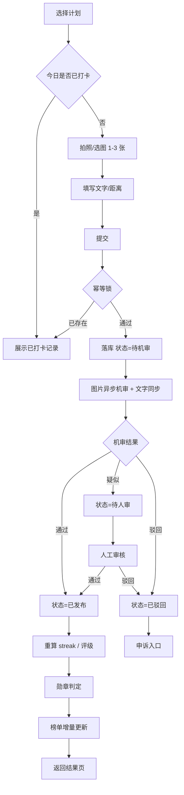

### 11.4 异常流程

| 场景 | 处理 |
| --- | --- |
| 图片上传失败 | 保留草稿（本地缓存 24h），重试入口；不进入提交状态 |
| 提交时断网 | 提示"网络异常"，草稿保留，恢复后一键重提 |
| 机审超时（> 30s） | 状态置"待人审"，用户端展示"审核中"，不影响 streak 计算的待定态 |
| 审核不通过 | 展示原因与申诉按钮，申诉 1 次，需 24h 内处理 |
| 断签 | 计划页提示"已断签"，提供补签（如有额度）与"重新开始"（保留历史，连续归零） |
| 账号被禁用 | 全站只读，提示联系客服 |

### 11.5 原型设计图（线框稿）

以下 12 张为关键页面的低保真线框稿，用于对齐**布局、信息层级与操作入口**，不定义视觉细节（配色与字体见第 12 章）。图片存放于 `docs/images/prototypes/`，由 `tools/gen_prototypes.py` 生成，改动后可一键重出。

**阅读约定**：灰色块 = 图片占位；深蓝 = 主操作；铜金 = 连续天数/勋章/奖励；红色 = 断签/驳回/风险。

#### 11.5.1 小程序端

**P-01 首页**

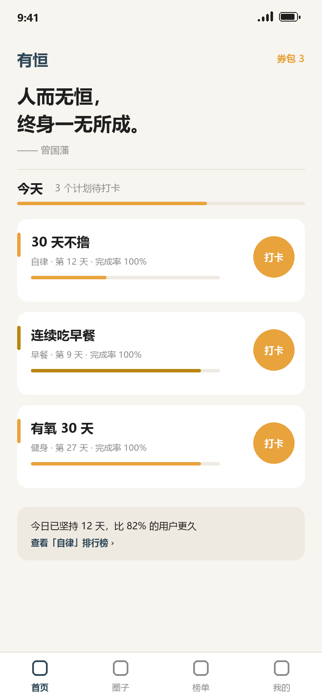

| 区域 | 内容 | 对应需求 |
| --- | --- | --- |
| 顶部语录 | 「人而无恒，终身一无所成」+ 曾国藩署名，全页最大文本 | 2.2 |
| 今日概览 | 待打卡计划数 + 当日完成进度条 | FR-5.4 |
| 计划卡片 | 计划名、标签、当前连续天数、完成率、快捷打卡圆钮 | FR-5.2 / FR-5.3 |
| 对比条 | 与全站用户的连续天数对比 + 榜单入口 | FR-5.5 |
| 券包入口 | 右上角显示余额，≥1 张时高亮 | FR-5.8.7 |

**P-03 计划详情（坚持纪律）**

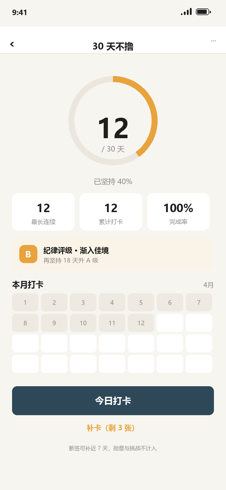

| 区域 | 内容 | 对应需求 |
| --- | --- | --- |
| 连续天数环 | 当前连续 / 目标天数，环形进度 40% | FR-5.4 |
| 三指标 | 最长连续、累计打卡、完成率 | FR-5.4 |
| 纪律评级 | B 级徽标 + 升级提示（再坚持 18 天升 A） | 7.4 |
| 打卡日历 | 月视图，已打卡日填充 | FR-5.8.3 |
| 主按钮 | 今日打卡（深蓝，页面唯一主操作） | FR-5.3 |
| 补卡入口 | 显示剩余券数，说明"勋章与挑战不计入" | FR-5.9.2 |

**P-04 打卡页**

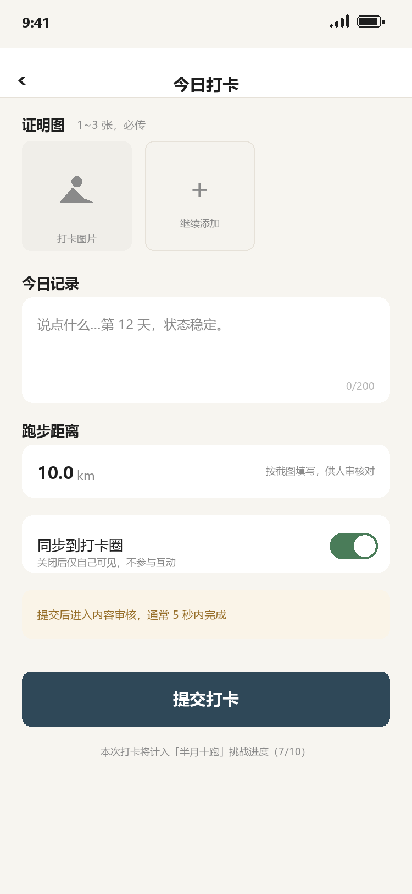

| 区域 | 内容 | 对应需求 |
| --- | --- | --- |
| 证明图 | 1~3 张，第一张必填，支持拍照/相册 | FR-5.3.1 |
| 文字记录 | ≤200 字，右下角实时字数 | FR-5.3.2 |
| 距离 | 跑步/骑行类计划必填，供人审核对 | 7.5 |
| 同步开关 | 同步打卡圈（默认开，关闭仅自己可见） | FR-5.2 |
| 审核提示 | 提交后进入审核的预期时长 | FR-5.3.4 |
| 挑战提示 | 本次打卡将计入哪个挑战进度 | FR-5.7.4 |

**P-06 标签榜单**

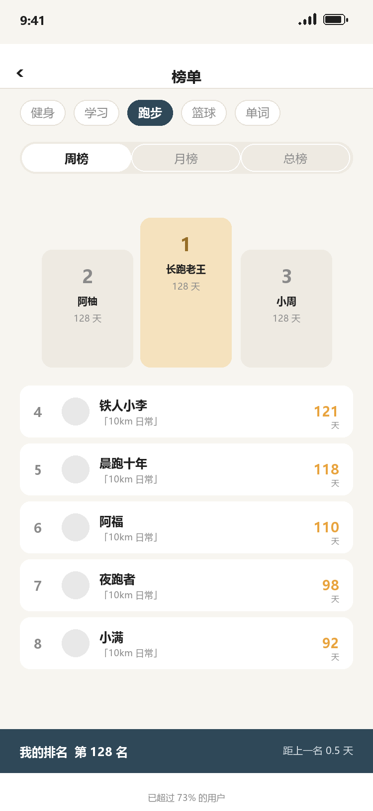

| 区域 | 内容 | 对应需求 |
| --- | --- | --- |
| 标签切换 | 横向滚动，选中态深蓝实心 | FR-5.5.1 |
| 周期切换 | 周榜 / 月榜 / 总榜 | 7.6 |
| 领奖台 | Top 3 差异化高度 | FR-5.5.2 |
| 榜单列表 | 4~100 名：昵称、计划名、连续天数 | FR-5.5.2 |
| 我的排名条 | 固定在底部，含名次与差距 | FR-5.5.3 |
| 百分位 | 100 名外展示"已超过 XX%" | 7.6 |

**P-07 打卡圈**

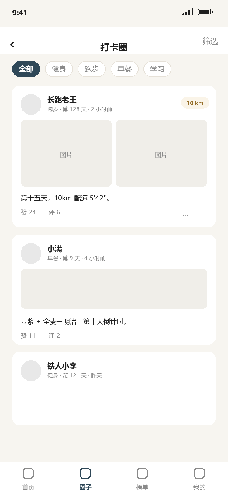

| 区域 | 内容 | 对应需求 |
| --- | --- | --- |
| 标签筛选 | 全部 / 各标签 | FR-5.6.1 |
| 动态卡片 | 头像、昵称、标签、连续天数、发布时间 | FR-5.6.1 |
| 图片 | 1~3 张九宫格，单图大图模式 | FR-5.6.1 |
| 互动区 | 点赞、评论、举报（"…"） | FR-5.6.2 / FR-5.6.4 |
| 距离角标 | 跑步类展示当次距离 | 7.5 |

**P-09 挑战详情**

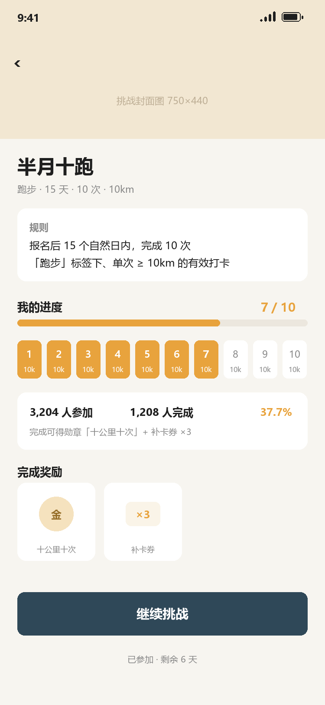

| 区域 | 内容 | 对应需求 |
| --- | --- | --- |
| 封面 | 750×440，标题浮于下方 | FR-5.7.2 |
| 规则卡 | 时间窗口 + 目标次数 + 单次标准（与 7.5 判定口径一致） | 7.5 |
| 进度 | 10 格进度条，已完成格填充铜金 | FR-5.7.3 |
| 参与数据 | 参加人数、完成人数、完成率 | FR-5.7.2 |
| 奖励预览 | 关联勋章 + 补卡券数量 | FR-6.8.3 / 5.9.2 |
| 主按钮 | 报名 / 继续挑战 / 已完成 | FR-5.7.3 |

**P-15 券包**

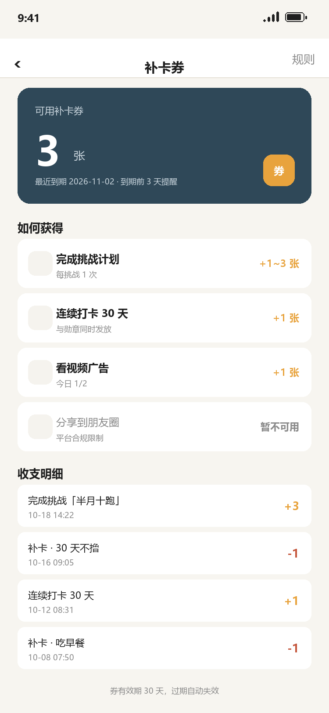

| 区域 | 内容 | 对应需求 |
| --- | --- | --- |
| 余额卡 | 可用张数、最近到期日、临期提醒 | FR-5.9.1 |
| 获取途径 | 完成挑战 / 里程碑 / 看广告 / 分享（灰显不可用） | 5.9.2 |
| 广告入口 | 显示当日剩余次数（今日 1/2） | FR-5.9.4 |
| 收支明细 | 来源、时间、±张数，近 90 天 | FR-5.9.6 |

> 图中"分享到朋友圈"一行故意画成**灰色不可用**，用于向评审直观表达合规结论（见 5.9.2 红框）。

**P-16 补卡**

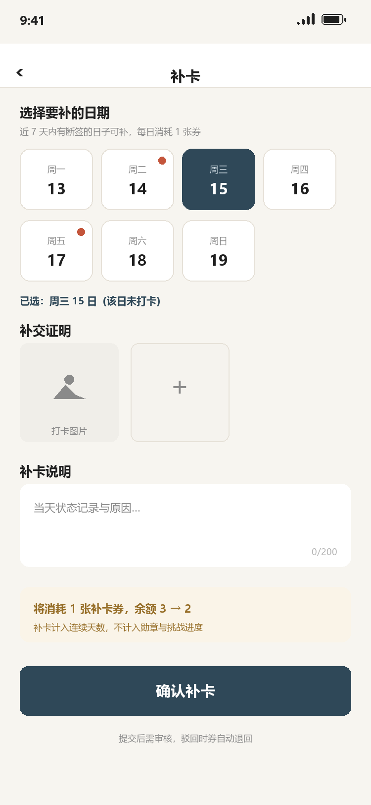

| 区域 | 内容 | 对应需求 |
| --- | --- | --- |
| 日期选择 | 近 7 天，断签日标红点，仅可选断签日 | 5.9.1 |
| 补交证明 | 同样需上传图片（补卡也是打卡） | FR-5.3.1 |
| 说明 | ≤200 字 | FR-5.3.2 |
| 消耗提示 | "余额 3 → 2" + 不计入勋章/挑战的说明 | 7.8 |
| 确认按钮 | 提交后进入审核，驳回退券 | FR-5.9.2 |

**P-17 邀请好友**

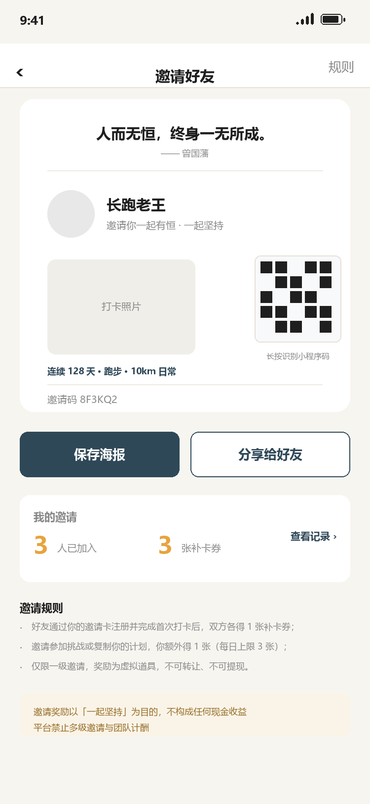

| 区域 | 内容 | 对应需求 |
| --- | --- | --- |
| 邀请卡 | 语录 + 邀请人昵称、头像、连续天数、打卡照片 | FR-5.10.1 |
| 小程序码 | `getUnlimited` 生成，scene 携带邀请码与类型 | 5.10.2 |
| 邀请码 | 6 位短码，可复制，作为扫码失败时的兜底 | 5.10.2 |
| 双按钮 | 保存海报 / 分享给好友（分享为可选，不强制） | FR-5.10.1 |
| 我的邀请 | 已邀请人数、已得券数、记录入口 | FR-5.10.5 |
| 规则说明 | 三级文案：怎么得、上限、不可提现 | 5.10.5 |
| 合规声明 | "不构成任何现金收益""禁止多级邀请"常驻底部 | 10.3 第 12 条 |

> 海报页刻意**不做"分享后才能领"的引导**，两个按钮并列、均可跳过——这是 5.1 诱导分享红线的直接落地。

#### 11.5.2 后台管理端

**A-05 打卡审核（待审队列）**

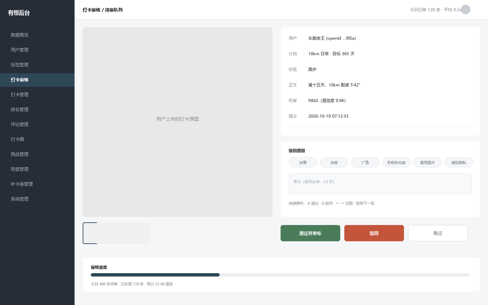

| 区域 | 内容 | 对应需求 |
| --- | --- | --- |
| 左侧导航 | 12 个一级菜单，当前项高亮 | 11.2 |
| 大图区 | 原图 1:1 展示，多图可切换（下方缩略图） | FR-6.3.2 |
| 信息卡 | 用户、计划、标签、正文、机审结果、提交时间 | FR-6.3.1 |
| 驳回原因 | 6 类预设原因，单选 | FR-6.3.3 |
| 备注 | 驳回必填 ≥5 字 | FR-6.3.3 |
| 操作区 | 通过并发布 / 驳回 / 跳过，附键盘快捷键 | FR-6.3.3 |
| 审核进度 | 今日待审量、已处理量、预计清空时间 | FR-6.3.7 |

**A-15 补卡券管理**

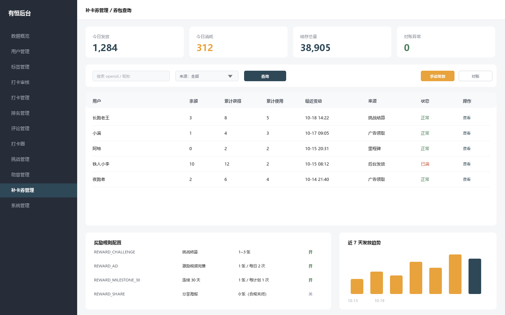

| 区域 | 内容 | 对应需求 |
| --- | --- | --- |
| 指标卡 | 今日发放、今日消耗、结存总量、对账异常 | FR-6.10.5 |
| 筛选栏 | openid/昵称、来源、查询、手动发放、对账 | FR-6.10.1 / FR-6.10.6 |
| 券包表格 | 用户、余额、累计获得/使用、最近变动、来源、状态 | FR-6.10.1 |
| 规则配置 | 各规则码的开关与数量，分享类显示"合规关闭" | FR-6.10.3 |
| 趋势图 | 近 7 天发放量 | FR-6.10.5 |

**A-18 日志审计**

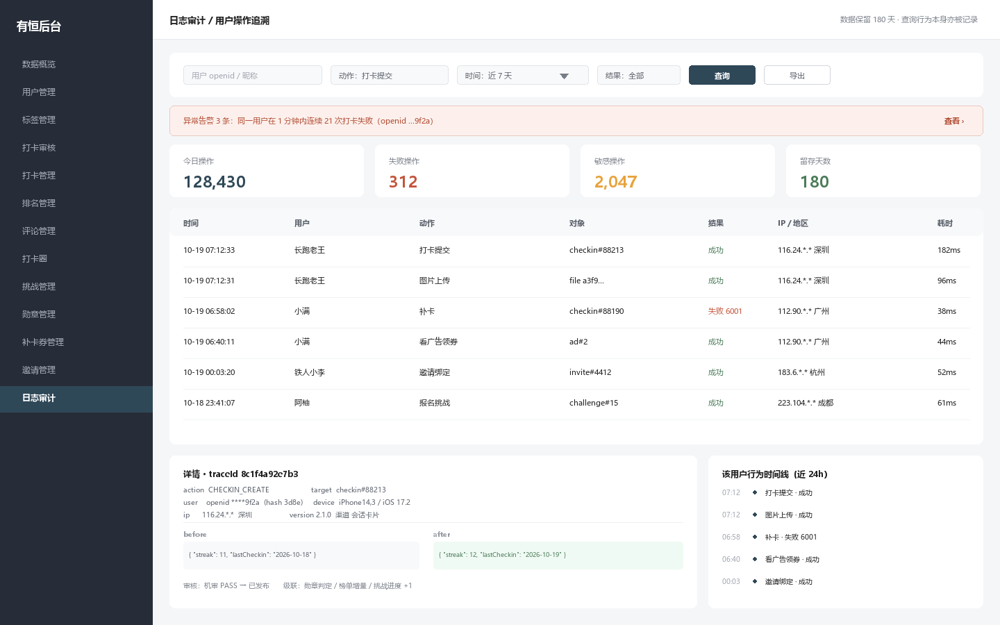

| 区域 | 内容 | 对应需求 |
| --- | --- | --- |
| 筛选栏 | 用户、动作、时间范围（必选）、结果、导出 | FR-6.13.1 / FR-6.13.2 |
| 异常告警条 | 同用户 1 分钟 21 次打卡失败，可点进详情 | FR-6.13.5 |
| 指标条 | 今日操作、失败数、敏感操作数、留存天数 | FR-6.13.1 |
| 日志表格 | 时间、用户、动作、对象、结果（失败带错误码）、IP/地区、耗时 | FR-6.13.1 |
| 详情面板 | action_code、target、openid 掩码 + hash、设备、版本、渠道、before/after 差异 | FR-6.13.3 |
| 时间线 | 该用户 24 小时内全部操作，客服排障主视图 | FR-6.13.4 |
| 顶栏提示 | "数据保留 180 天 · 查询行为本身亦被记录" | FR-6.13.8 |

> 注意详情面板里 `before` / `after` 展示的是 **streak 从 11 变 12** 这种业务字段差异，而不是原始 HTTP 报文——这是审计日志与访问日志最大的区别。

> 注：以上均为**线框稿**，用于确认信息结构与操作路径；视觉稿（配色、字体、图标、切图标注）在 UI 阶段单独交付，规范见第 12 章。

---

## 12. 视觉与文案规范

### 12.1 品牌

- 名称：有恒；英文 youheng。
- Logo 方向：印章式「恒」字 + 链条元素，单色可印。
- 首页固定语录：**人而无恒，终身一无所成。—— 曾国藩**
- 语录字号需为页面最大文本，居中，竖排或居中横排均可，下方留白 ≥ 48px。

### 12.2 色彩与字体

| 用途 | 色值 | 说明 |
| --- | --- | --- |
| 主色 | `#2F4858`（墨蓝） | 沉稳，用于导航与主按钮 |
| 成功/连续 | `#E8A33D`（铜金） | 连续天数、勋章 |
| 警示 | `#C4553B`（朱砂） | 断签、驳回 |
| 背景 | `#F7F5F0`（宣纸白） | 页面底色 |
| 正文 | `#1F1F1F` | — |
| 次要文字 | `#8A8A8A` | — |

- 中文标题：思源宋体 / 苹方（降级）；数字：DIN Alternate 或 Bebas Neue（连续天数用大号数字）。
- 圆角：卡片 12px，按钮 8px；阴影极轻（不超过 8% 黑）。

### 12.3 文案规范

| 禁用表述 | 替代表述 | 原因 |
| --- | --- | --- |
| 戒色、戒撸、不撸 | 自律、克己、清心 | 平台内容规范 |
| 保证、一定、100% 成功 | 有助于、更容易 | 禁用绝对化承诺 |
| 最、第一、唯一 | 领先、更专注 | 广告法 |
| 治疗、治愈、康复 | 养成、改善 | 医疗建议风险 |
| 打卡失败、你失败了 | 今日未打卡、重新出发 | 降低负向情绪 |
| 分享得补卡券、分享解锁 | 生成打卡海报 | 诱导分享，平台禁止 |
| 邀请返现、拉新奖励、团队计酬 | 邀请好友一起有恒 | 多级分销红线 |
| 看广告必得、百分百中奖 | 看广告领 1 张（每日 2 次） | 虚假承诺 |

- 语气：第二人称、短句、不感叹号堆叠。
- 错误提示必须包含"发生了什么 + 怎么办"。

---

## 13. 验收标准

| 编号 | 场景 | 预期结果 |
| --- | --- | --- |
| AC-01 | 新用户微信授权登录 | 自动建号，返回 JWT，首页展示语录与空状态引导 |
| AC-02 | 创建"30 天不撸"计划，选标签"自律"，关闭同步圈子 | 创建成功，天数自动算为 30，打卡圈不出现该内容 |
| AC-03 | 同一天对同一计划提交两次打卡 | 第二次返回 3001，不产生新记录，不重复计数 |
| AC-04 | 上传含违规内容的图片 | 机审驳回，展示原因，可申诉，streak 不增加 |
| AC-05 | 连续 7 天打卡 | 第 7 天获得对应勋章，站内信通知，榜单分数更新 |
| AC-06 | 中断 1 天后再次打卡 | 连续天数归 1，最长连续保留，评级下降 |
| AC-07 | 使用补签修复断签 | streak 恢复，补签日标记，勋章进度不增加 |
| AC-08 | 报名"15 天 10 次 10km 跑步"并完成 10 次 | 自动结算，颁发关联勋章，挑战页显示已完成 |
| AC-09 | 后台驳回某打卡 | 用户端状态变为已驳回，打卡圈不可见，可申诉 |
| AC-10 | 后台禁用用户 | 该用户所有接口返回 1002，无法打卡与评论 |
| AC-11 | 标签榜按周切换 | 周一 00:00 后数据归零，上一周期可查快照 |
| AC-12 | 同一用户在同一标签下有 3 个计划 | 榜单只出现 1 条，取连续天数最高者 |
| AC-13 | 统计接口查询近 7 天 | 返回 7 个数据点，含注册、在线、打卡、审核指标 |
| AC-14 | 图片重复使用（同一张图打不同计划的卡） | 第二次命中 pHash，标记可疑并进人审 |
| AC-15 | 完成"15 天 10 次 10km 跑步"挑战 | 结算后补卡券 +1~3 张到账，券包余额同步，账本新增 1 条获得流水 |
| AC-16 | 券包余额 0 时点击补卡 | 返回 6001，弹窗引导"看广告领券 / 参加挑战"，不产生补卡记录 |
| AC-17 | 持有 10 张券时再完成挑战 | 返回 6002 或记录"待领取"，余额不超过 10 |
| AC-18 | 看激励视频广告未看完即关闭 | 不发券，返回 6005，当日次数不扣减 |
| AC-19 | 同一天连续请求领券 3 次 | 第 3 次返回 6003（超每日 2 次），并写入 `ad_reward_log` |
| AC-20 | 券已过期后再用于补卡 | 券不可选，提示"已过期"，账本无扣减 |
| AC-21 | 补卡提交后被人工驳回 | 券自动退回，有效期恢复，用户收到站内信 |
| AC-22 | 同一挑战重复结算（定时任务重跑） | 券只发一次，账本唯一索引拦截，余额不变 |
| AC-23 | 单计划当月已用 4 张券后再补卡 | 返回 6004，提示"本月补卡次数已用完" |
| AC-24 | 后台对账任务发现余额与账本不一致 | 生成告警记录，可在后台查看差异明细 |
| AC-25 | 新用户扫邀请码注册并完成首次打卡 | 邀请关系绑定成功，双方各得 1 张补卡券，`invite_record` 变为已发奖 |
| AC-26 | 新用户注册后 7 天零打卡 | 记录置为已过期，邀请人不发券，被邀请人的 1 张券仍发 |
| AC-27 | 同一设备注册第二个账号并走邀请 | 不计入有效邀请，邀请人无奖励，返回 7004（不暴露风控原因） |
| AC-28 | 老用户点击他人邀请卡 | 提示已绑定（7002），但可正常报名挑战 / 复制计划 |
| AC-29 | 被邀请人点同一个邀请卡两次 | 幂等，只生成一条 `invite_record`，只发一次券 |
| AC-30 | 邀请人 1 小时内产生 11 条邀请记录 | 第 11 条起冻结奖励，账号进风控名单并告警 |
| AC-31 | 复制他人计划 | 生成新计划（独立进度），`plan_companion` 建立同行关系，双方互见连续天数 |
| AC-32 | 邀请人 10 级链路 A→B→C→D | 只有 A→B、B→C、C→D 各自一级有效，A 不因 C、D 获得任何奖励 |
| AC-33 | 用户提交一次打卡 | `audit_log` 新增一条 `CHECKIN_CREATE`，含 traceId、耗时、before/after 差异 |
| AC-34 | 前端伪造 `X-Forwarded-For` 首值 | 服务端取网关透传的真实 IP，审计记录的是真实 IP 而非伪造值 |
| AC-35 | 审计写入时数据库超时 | 打卡仍成功返回，用户无感；审计侧重试后落本地文件并触发告警 |
| AC-36 | 后台查询审计日志未指定时间范围 | 返回 8001，提示"请选择时间范围（≤90 天）" |
| AC-37 | 管理员查询某用户的操作日志 | 该次查询本身写入一条 `AUDIT_QUERY`，含查询条件摘要 |
| AC-38 | 用应用账号执行 `UPDATE audit_log` | 数据库权限拒绝；后台也无任何编辑/删除入口 |
| AC-39 | 审计队列打满 10 万条 | 非敏感事件丢弃并打点，`sensitive=true` 的事件仍同步落库，不丢资产类操作 |
| AC-40 | 用户注销后查询其历史日志 | openid 已转为不可逆哈希，仍可按业务 ID 查到记录用于举证 |

---

## 14. 里程碑与版本规划

### 14.1 V1.0（MVP，6 周）

| 周 | 目标 | 交付物 |
| --- | --- | --- |
| W1 | 架构搭建 | 工程骨架、Flyway 基线、登录鉴权、标签字典、CI |
| W2 | 计划与打卡 | 计划 CRUD、图片上传、机审接入、打卡状态机 |
| W3 | 纪律与排名 | streak 算法、纪律看板、Redis 榜、接口联调 |
| W4 | 社区 | 打卡圈信息流、点赞评论、举报、后台审核台 |
| W5 | 挑战与勋章 | 挑战配置与报名、结算任务、勋章颁发、消息中心 |
| W6 | 补卡券、邀请与后台收口 | 补卡券账本与消耗、奖励发放、邀请绑定与奖励、后台管理页、数据统计、全链路测试、备案材料、提审 |

### 14.2 V1.1（上线后 4 周）

- 激励视频广告接入（流量主开通后）、连续段平均指标、分享海报、话题、审核质检报表、券包"待领取"兜底。

### 14.3 V2.0（探索）

- 好友关注与好友榜、AI 图片真实性识别、计划模板市场、会员增值（去广告/高级统计）、补卡券商城、多端（H5/App）。

### 14.4 版本号与发布

- 语义化版本 `主.次.修订`；小程序体验版 → 审核 → 全量；后端蓝绿发布。
- 每次发布附带：变更说明、DB 迁移清单、回滚方案。

---

## 15. 风险与待确认事项

### 15.1 风险

| 风险 | 等级 | 应对 |
| --- | --- | --- |
| 内容审核误判导致用户流失 | 高 | 双通道（机审+人审）、申诉一次、SLA 24h、误判统计周报 |
| 图片存储成本增长快 | 中 | 压缩至 500KB、冷数据转低频存储、180 天后仅保留缩略图 |
| 刷榜作弊 | 高 | pHash 去重、设备/IP 聚类、驳回扣分、人工剔除、禁榜 |
| 备案与审核周期不可控 | 中 | W6 前提交备案材料，预留 2 周五缓冲 |
| 规则口径反复变更 | 高 | 规则集中在第 7 章，变更需评审并升版本号 |
| 打卡圈冷启动内容少 | 中 | 挑战活动带量、官方话题、不造假数据但可置顶优质内容 |
| 单表数据量过大 | 中 | 提前按月分区、归档策略、慢查询监控 |
| 分享发券被判定诱导分享 | **高** | 默认关闭分享奖励；改为挑战/里程碑/广告发券；提审前自查全站文案 |
| 广告刷量骗券 | 中 | 每日 2 次硬上限、设备指纹、1 小时高频请求进风控、服务端复核完播 |
| 券超发导致账本与余额不一致 | 中 | 账本唯一索引幂等、事务内扣减、每日 02:00 对账告警 |
| 流量主未达开通门槛 | 中 | 广告入口做成开关，未开通自动隐藏；前期用挑战发券替代 |
| 邀请刷量（小号互邀） | **高** | 设备指纹去重、同 IP 聚类、首次打卡才发券、每日 3 次/每月 20 次上限、风控名单 |
| 邀请被判定多级分销 | **高** | 只做一级、无团队报表、奖励仅虚拟道具、文案中性；提审前逐条对照 5.10.5 |
| 邀请链路转化低（分享无奖励后） | 中 | 靠"一起坚持"的同伴感 + 被邀请人得券驱动；观察 K 因子，低于 0.1 再调策略 |
| scene 参数超长导致码生成失败 | 中 | scene ≤32 字符，短码 6 位 + 单字母类型 + 数字 ID；上线前实测最长组合 |
| 审计写入放大拖慢主流程 | **高** | 全程异步队列 + 批量写；切面 try-catch 吞异常；敏感操作才走同步兜底 |
| 审计表膨胀导致查询变慢 | 中 | 按月分区、只查 90 天内、禁止全表模糊、大字段拆表；数据再涨上 ES |
| 日志本身泄露隐私 | **高** | 入库前脱敏（openid 掩码 + hash、不存签名 URL、禁记密码）；查询权限单独收口 |
| 内部人员滥用审计查询 | 中 | 查询与导出均留痕（`AUDIT_QUERY`/`AUDIT_EXPORT`），按周抽查 |

### 15.2 待确认事项（需需求方逐条回复）

| 编号 | 问题 | 建议方案 |
| --- | --- | --- |
| Q1 | 工程名拼写（出现过 yuhen、youhen、youheng 三种写法） | **已确认：统一 `youheng`**，详见 1.5 |
| Q2 | "半个月连续 10km 跑步 10 次"是次数型还是连续型？ | 按次数型（15 天内 10 次） |
| Q3 | "平均多少天"指平均间隔还是平均连续长度？ | 个人页两个都展示，榜单按最长连续 |
| Q4 | 补签是否计入连续天数与勋章？ | 计入连续，不计入勋章与挑战 |
| Q5 | 排名周期默认周榜还是总榜？ | 默认周榜，可切总榜 |
| Q6 | 打卡圈是否需要审核后才展示（而非先展示后审核）？ | 先审后发，避免合规风险 |
| Q7 | 挑战计划是否需要审核后发布，还是运营可直接发布？ | 运营可直接发布，超管可撤回 |
| Q8 | 是否需要手机号绑定？ | 不需要，纯 openid 体系 |
| Q9 | 数据统计的"在线用户"口径是否认可 5 分钟窗口？ | 认可；如需更实时可降到 2 分钟 |
| Q10 | 是否允许用户自定义标签？ | 不允许，仅平台字典 |
| Q11 | 勋章是否可撤销、撤销后是否通知用户？ | 可撤销，必须通知并展示原因 |
| Q12 | 是否规划付费功能（会员/增值）？ | V2.0 再定，V1.0 不涉及支付 |
| Q13 | 分享到朋友圈发券是否保留？ | **建议删除**（诱导分享违规）；如坚持保留需法务签字并承担封禁风险 |
| Q14 | 补卡券有效期 30 天、持有上限 10 张是否合适？ | 建议先用此默认值，运营数据跑 1 个月后再调 |
| Q15 | 看广告领券每日 2 次是否够？ | 建议 2 次；需先攒够 1000 UV 开通流量主后才能上线 |
| Q16 | 单计划每月补卡上限 4 张是否过松？ | 建议 4 张，重计划（365 天）可放宽到 8 张（按挑战配置） |
| Q17 | 补卡券是否需要支持"赠送好友"？ | V2.0 再定，涉及交易与诈骗风险，V1.0 禁止转让 |
| Q18 | 邀请奖励是单方（仅邀请人）还是双向？ | 建议双向：邀请人 +1、被邀请人 +1，新用户冷启动更容易 |
| Q19 | "参加我的计划"是共享进度还是各自独立？ | **建议各自独立（复制模式）**，共享进度需引入成员与权限，V2.0 再做 |
| Q20 | 邀请奖励是否要设"被邀请人完成首次打卡"门槛？ | 必须设，否则注册即走的黑产能在一天内刷空券池 |
| Q21 | 审计日志在线保留 180 天是否够？ | 满足网络安全法 6 个月下限；如需 2 年在线需评估存储成本 |
| Q22 | 审计查询是否现在就上 Elasticsearch？ | 建议先 MySQL 分区 + 索引，日查询量超 200 次/天或总量超 2 亿再迁 ES |
| Q23 | 是否需要对"最终用户"开放自己的操作日志（个人数据可携带）？ | V1.x 不做；如遇合规问询再补导出接口 |

---

## 16. 附录

### 16.1 附录 A：初始标签与勋章

**标签（7 个）**

| 编码 | 名称 | 主色 | 开放排名 |
| --- | --- | --- | --- |
| `fitness` | 健身 | `#E8A33D` | 是 |
| `study` | 学习 | `#2F4858` | 是 |
| `running` | 跑步 | `#C4553B` | 是 |
| `basketball` | 篮球 | `#D98324` | 是 |
| `words` | 单词计划 | `#4A7C59` | 是 |
| `sleep` | 睡眠 | `#5B6C8F` | 是 |
| `breakfast` | 早餐 | `#B8860B` | 是 |

**勋章（里程碑 12 枚，节选）**

| 编码 | 名称 | 稀有度 | 条件 |
| --- | --- | --- | --- |
| `STREAK_7` | 七日之约 | 铜 | 连续 7 天 |
| `STREAK_21` | 廿一日 | 银 | 连续 21 天 |
| `STREAK_30` | 三十日 | 银 | 连续 30 天 |
| `STREAK_66` | 六十六日 | 金 | 连续 66 天（习惯成自然） |
| `STREAK_100` | 百日筑基 | 金 | 连续 100 天 |
| `STREAK_365` | 恒者 | 钻 | 连续 365 天 |
| `TOTAL_50` | 五十次 | 铜 | 累计打卡 50 次 |
| `TOTAL_200` | 两百次 | 银 | 累计打卡 200 次 |
| `FULL_MONTH` | 满月无缺 | 金 | 单月应打卡日全部完成，且无补签 |
| `CHALLENGE_RUN10` | 十公里十次 | 金 | 完成"15 天 10km×10"挑战 |
| `MORNING_21` | 晨间二十一日 | 银 | 连续 21 天在 08:00 前打卡 |
| `EARLY_BIRD` | 早起者 | 铜 | 连续 10 天在 06:30 前打卡 |

> 勋章图标规格：512×512 PNG，透明底，单枚 ≤ 50KB。

### 16.2 附录 B：状态机

**打卡状态机**

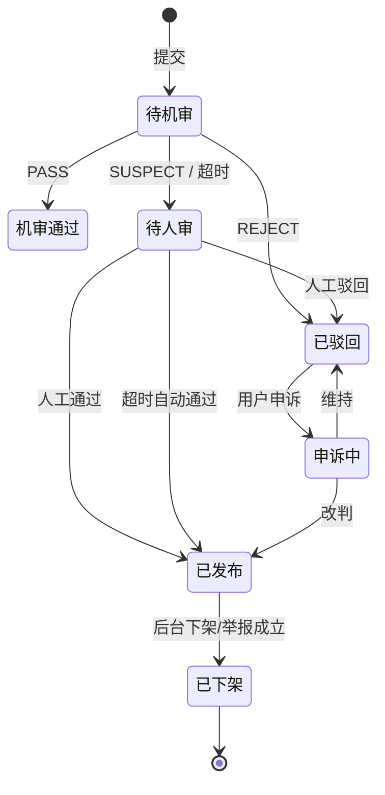

**挑战状态机**：`草稿 → 待发布 → 进行中 → 已结束 → 已结算`；任意阶段可由超管 `终止`。

### 16.3 附录 C：定时任务清单

| 任务 | 频率 | 说明 |
| --- | --- | --- |
| `streakRecomputeJob` | 每日 00:10 | 全量重算连续天数与评级（纠偏） |
| `badgeGrantJob` | 每 5 分钟 | 扫描达标未发勋章的用户并补发 |
| `challengeSettleJob` | 每 5 分钟 | 挑战完成结算与勋章颁发 |
| `challengeCloseJob` | 每日 00:20 | 关闭到期挑战，置未完成 |
| `rankRebuildJob` | 每小时 | 全量重建标签榜 ZSET |
| `rankSnapshotJob` | 每周一 00:05 | 生成周榜快照 |
| `statAggregateJob` | 每日 01:00 | 汇总 `stat_daily` |
| `auditTimeoutJob` | 每 10 分钟 | 人审超时自动通过并打标 |
| `cardExpireJob` | 每日 00:30 | 将过期券实例置为已过期，写失效流水，扣减快照 |
| `cardReconcileJob` | 每日 02:00 | 账本汇总与 `user_card.balance` 对账，差异告警 |
| `cardPendingClaimJob` | 每日 09:00 | 提醒"待领取"的补卡券（券包曾满的用户） |
| `adRewardStatJob` | 每日 01:30 | 汇总广告请求/完播/领券数据 |
| `inviteActivateJob` | 每 10 分钟 | 扫 `PENDING` 记录，被邀请人已首次打卡则置 `ACTIVATED` 并尝试发奖 |
| `inviteExpireJob` | 每日 00:40 | 超 30 天未激活的记录置 `EXPIRED` |
| `inviteRiskJob` | 每小时 | 按设备/IP/频次聚类，标记异常邀请，更新风控名单 |
| `auditAlertScanJob` | 每 5 分钟 | 扫描审计日志，命中批量失败/高频/异地规则则生成告警 |
| `auditArchiveJob` | 每月 1 日 04:00 | 超 180 天的分区导出 OSS 冷存储并删除在线分区 |
| `auditReconcileJob` | 每日 03:00 | 比对审计条数与业务表变更数，缺口告警 |
| `dataArchiveJob` | 每月 1 日 03:00 | 冷数据归档 |

### 16.4 附录 D：交付物清单

| 交付物 | 说明 |
| --- | --- |
| 本需求说明书 | `docs/需求/youheng设计需求文档说明书.md` |
| 数据库设计 | `docs/数据库/youheng-db-design.md` + Flyway 脚本 |
| 接口文档 | OpenAPI 3 自动生成 + `docs/接口/` 导出 |
| 原型 | 12 张关键页面线框图，见 `docs/images/prototypes/`（生成脚本 `tools/gen_prototypes.py`） |
| 测试用例 | 基于第 13 章展开，≥ 120 条 |
| 部署手册 | `deploy/README.md` |

---

**文档结束**

> 评审通过后，本文件冻结为 V1.0 基线；任何需求变更以 `V1.1` 修订记录的形式追加，不得直接改写既有条目。
